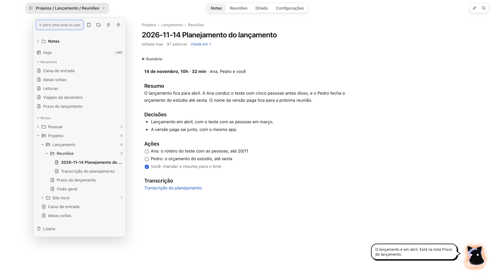

# Kiwi Notes

**A local second brain for the Mac: dictation, notes and meetings, all on your computer.**

[Português](README.pt-BR.md)

<picture>
  <source media="(prefers-color-scheme: dark)" srcset="docs/design/readme/hero-dark.webp">
  
</picture>

- **Dictation** anywhere: hold a key, speak, and the text lands where the cursor is, cleaned up and in the right tone for the app.
- **Notes** in plain Markdown, in a folder you choose, compatible with Obsidian.
- **Meetings** recorded and transcribed on the Mac, turned into a note with the summary, the decisions and the actions.
- **The Kiwi Cat**, an optional agent you talk to with a key, that reads and organizes your notes.

## Download

Get the latest version from [Releases](https://github.com/kiwi-init/kiwinotes/releases). Kiwi Notes is signed and updates itself. It needs macOS on Apple silicon.

## Privacy

- Everything stays on your Mac: speech-to-text, your notes and your recordings. No telemetry, no analytics.
- The only thing that leaves is what you send to the agent you choose, and it comes turned off. Audio never leaves.
- Details in [ADR 0011](docs/adr/0011-agente-e-privacidade.md).

## Build and test

```sh
cd app
bun install
bun dev              # build the UI and open the app in the menu bar
bun test             # the TypeScript logic
bun run typecheck    # in a new checkout, run `bun run prepare:eb` first
cd ../native && swift test   # the Swift helper
```

The app runs headless too, with nothing on screen: see [app/README.md](app/README.md).

## Docs

- [AGENTS.md](AGENTS.md): how the work is done, for people and agents (branches, PRs, privacy rules, tests).
- [docs/specs](docs/specs): the approved specs. [docs/adr](docs/adr): the architecture decisions.
- [docs/design](docs/design): the brand and the Kiwi Cat art. [docs/research](docs/research): research notes.
- [CHANGELOG.md](CHANGELOG.md): what changed in each version. [docs/arquivo.md](docs/arquivo.md): what left the repo, and where to find it.

Stack: Electrobun Livewire (Bun + WKWebView), React, TypeScript and Vite, and a native helper in Swift. Licenses of ported code are in [licenses](licenses) and [NOTICE](NOTICE).
