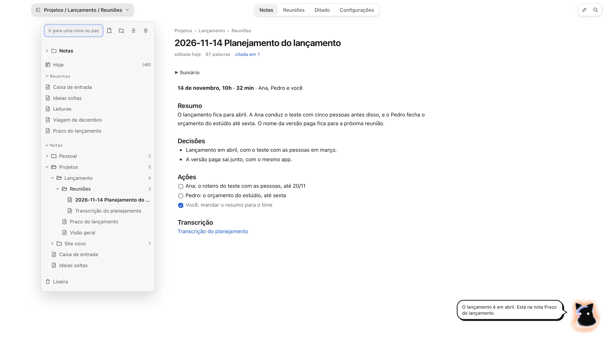

# Kiwi Notes

**Um segundo cérebro local para o Mac: ditado, notas e reuniões, tudo no seu computador.**

[English](README.md)

<picture>
  <source media="(prefers-color-scheme: dark)" srcset="docs/design/readme/hero-dark.webp">
  
</picture>

- **Ditado** em qualquer lugar: segure uma tecla, fale, e o texto aparece onde está o cursor, limpo e no tom certo para o app.
- **Notas** em Markdown comum, numa pasta que você escolhe, compatível com o Obsidian.
- **Reuniões** gravadas e transcritas no Mac, que viram uma nota com o resumo, as decisões e as ações.
- **O Kiwi Cat**, um agente opcional com quem você fala por uma tecla, que lê e organiza as suas notas.

## Download

Baixe a versão mais nova em [Releases](https://github.com/kiwi-init/kiwinotes/releases). O Kiwi Notes é assinado e se atualiza sozinho. Ele pede macOS num Mac com Apple silicon.

## Privacidade

- Tudo fica no seu Mac: o reconhecimento da fala, as suas notas e as gravações. Sem telemetria, sem analytics.
- Só sai o que você manda ao agente que escolher, e ele vem desligado. O áudio nunca sai.
- Os detalhes estão na [ADR 0011](docs/adr/0011-agente-e-privacidade.md).

## Construir e testar

```sh
cd app
bun install
bun dev              # builda a UI e abre o app na barra de menu
bun test             # a lógica em TypeScript
bun run typecheck    # numa cópia nova, rode antes `bun run prepare:eb`
cd ../native && swift test   # o helper em Swift
```

O app também roda headless, sem nada na tela: veja o [app/README.md](app/README.md).

## Documentação

- [AGENTS.md](AGENTS.md): como o trabalho é feito, para pessoas e agentes (branches, PRs, regras de privacidade, testes).
- [docs/specs](docs/specs): os specs aprovados. [docs/adr](docs/adr): as decisões de arquitetura.
- [docs/design](docs/design): a marca e a arte do Kiwi Cat. [docs/research](docs/research): as pesquisas.
- [CHANGELOG.md](CHANGELOG.md): o que mudou em cada versão. [docs/arquivo.md](docs/arquivo.md): o que saiu do repo, e onde achar.

Stack: Electrobun Livewire (Bun + WKWebView), React, TypeScript e Vite, e um helper nativo em Swift. As licenças do código portado estão em [licenses](licenses) e no [NOTICE](NOTICE).
