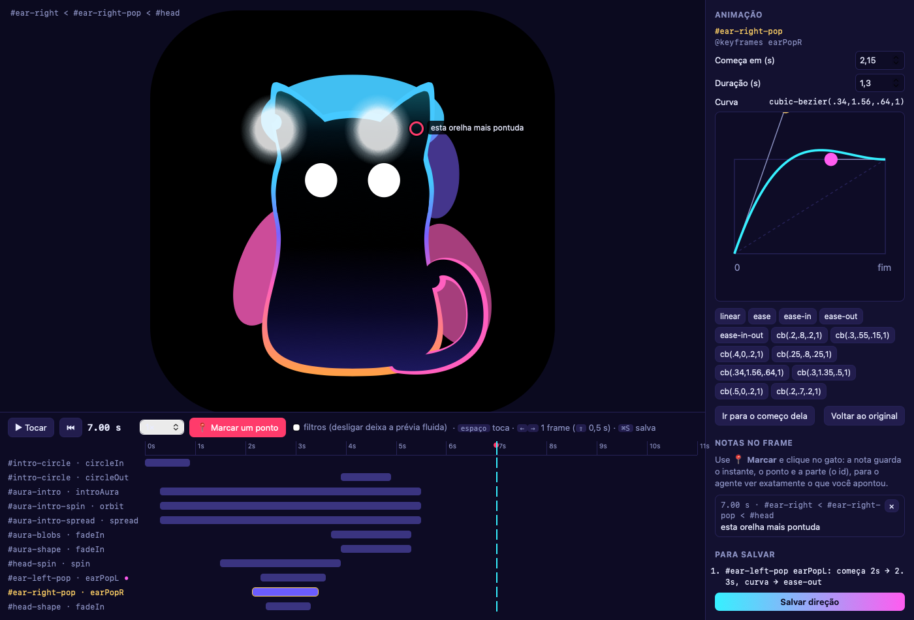
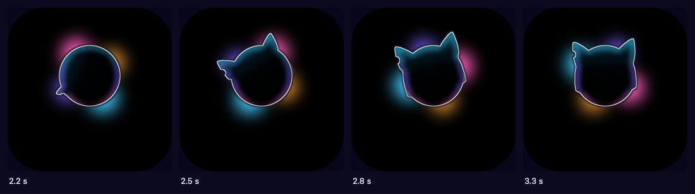
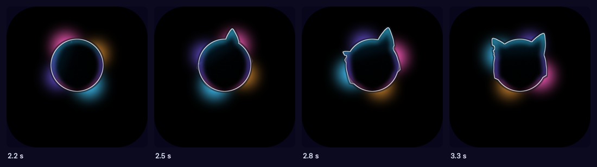
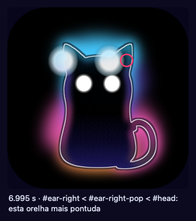

# O diretor do Kiwi-cat (T3065)

Uma página local para o harry **mostrar** como quer a animação, em vez de descrever. Ele ajusta o tempo e a curva de
cada parte arrastando, e marca pontos num frame ("esta orelha, aqui, aos 2,4 s"). O Salvar grava um `direcao.json` ao
lado do SVG, e o agente aplica exatamente aqueles números. A pesquisa que levou a isso está em
[`docs/research/kiwicat-animacao.md`](../../research/kiwicat-animacao.md).



## Para o harry
```sh
bun docs/brand/diretor/servir.ts
```
Depois, abra `http://127.0.0.1:4790/` no Safari ou no Chrome. Tudo roda só nesta máquina, sem nada da internet.

- **Tocar e parar:** `espaço`. Para andar um frame, `←` e `→`; com `⇧`, meio segundo. Para ir a um instante, clique na régua.
- **Mudar quando uma parte entra:** arraste a barra dela. Para mudar quanto ela dura, arraste a ponta direita da barra.
  Ela encaixa de 0,05 em 0,05 s; com `⌥`, fica livre.
- **Mudar a curva:** clique na barra, ou na parte do gato, e arraste as duas bolinhas do gráfico à direita. Os botões
  embaixo dele são as curvas prontas e as que o gato já usa.
- **Apontar algo:** use **📍 Marcar um ponto** (`M`), clique no gato e escreva o que quer ali. A nota guarda o
  instante, o ponto e o nome da parte (`#ear-right < #ear-right-pop < #head`).
- **Mostrar a prévia fluida:** desligue "filtros". O brilho e o blur do SVG pesam no navegador, e sem eles o tempo
  fica exato. As mudanças são as mesmas.
- **Salvar:** `⌘S` ou o botão. Depois, avise no canal: "salvei a direção do gato".

## Para o agente
1. **Ler as notas e ver o frame de cada uma**, com o anel no ponto marcado:
   ```sh
   kiwi lock bench --wait 30m
   bun docs/brand/diretor/quadros.ts --notas --out /tmp/notas.png
   ```
2. **Aplicar o tempo e as curvas.** Rode primeiro com `--seco` para conferir:
   ```sh
   bun docs/brand/diretor/aplicar.ts --seco
   bun docs/brand/diretor/aplicar.ts
   ```
   - Ele reescreve só o `animation:` daquelas regras, com os números exatos, e tira da lista o que aplicou. As notas
     ficam.
   - Se o SVG mudou depois que o harry marcou, ele recusa e diz o que mudou. Para aplicar mesmo assim, use `--forcar`.
3. **Ver antes e depois:**
   ```sh
   bun docs/brand/diretor/quadros.ts --t 2.2,2.5,2.8 --out /tmp/depois.png
   ```
4. **Levar para a intro do app** e abrir o PR:
   ```sh
   bun docs/brand/intro/gerar.ts
   ```

Outro SVG funciona com `--svg caminho.svg`, tanto no `servir` quanto no `aplicar` e no `quadros`.

## A mudança de exemplo
Um teste ponta a ponta, feito numa cópia do SVG:
1. no diretor, a orelha esquerda passou a começar em 2,3 s e não em 2,0 s, com a curva `ease-out`;
2. o Salvar gravou isto:
   ```json
   { "seletor": "#ear-left-pop", "animacao": "earPopL", "atraso": 2.3, "curva": "ease-out",
     "de": { "duracao": 1.3, "atraso": 2, "curva": "cubic-bezier(.34,1.56,.64,1)" } }
   ```
3. o `aplicar.ts` mudou uma linha:
   ```diff
   -    #ear-left-pop { animation: earPopL 1.3s cubic-bezier(.34,1.56,.64,1) 2.0s both; }
   +    #ear-left-pop { animation: earPopL 1.3s ease-out 2.3s both; }
   ```

Os frames de 2,2 s, 2,5 s, 2,8 s e 3,3 s, antes e depois. Aos 2,5 s, a orelha esquerda ainda não saiu:




A nota "esta orelha mais pontuda", como o agente a vê:



## O que ele não faz (ainda)
- Não muda a forma: o desenho de uma orelha, por exemplo, nem os valores dentro dos `@keyframes`, como o quanto ela gira.
  Isso hoje vira uma nota, e o agente responde com 2 ou 3 variantes lado a lado, pelo `quadros.ts`, para o harry escolher.
- Não cobre o começo da intro, do prisma até a bola (`docs/brand/intro/intro.js`), que é animado por script, e não por CSS.

## Arquivos
- `animacao.ts` lê e reescreve o `animation:`. É o mesmo código na prévia e no `aplicar`, então o que aparece na tela
  é o que vai para o arquivo. Os testes estão em `animacao.test.ts`:
  ```sh
  bun test docs/brand/diretor
  ```
- `servir.ts` é o servidor. Ele atende só pelo `127.0.0.1:<porta>`: o `Host` é conferido, o que barra DNS rebinding. Só a própria página grava, e só curvas e tempos válidos. Os testes estão em `servir.test.ts`.
- `index.html` e `diretor.js` formam a página.
- `aplicar.ts` grava o `direcao.json` no SVG.
- `quadros.ts` monta a prancha de frames, que é o "olho" do agente.
