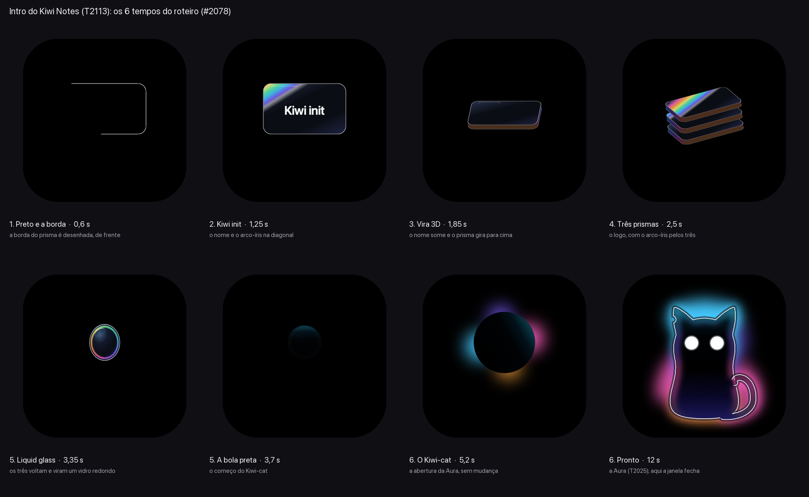

# A intro do Kiwi Notes (T2113, protótipo)

A animação de abertura do spec #2078, aprovado pelo harry (#2111): Kiwi init → Channels → Kiwi-cat. Este é o protótipo
em HTML para o harry aprovar. A janela `intro` no app vem numa task própria, ligada ao hub (`HubDeps.intro`, T2121).

**Para ver:** abra `intro.html` no Safari. Um clique pula, e "De novo" toca outra vez.
- `?gato=2`: a abertura do gato no dobro da velocidade.
- `?t=2.5`: congela o frame daquele instante.

## Os 6 tempos
| s | O que acontece |
|---|---|
| 0,0 | Preto: a base do ícone aparece, e a borda de um prisma é desenhada, de frente. |
| 0,8 | "Kiwi init" aparece no meio, e o arco-íris passa pelo prisma na diagonal. |
| 1,5 | O nome some, e o prisma vira 3D, girando no próprio eixo para cima. |
| 2,0 | Ele se expande em três prismas (o logo), com o arco-íris passando pelo vidro dos três. |
| 2,7 | Os três voltam para dentro de si e viram um liquid glass redondo, que vira uma bola preta. |
| 3,7 | Da bola começa a abertura do Kiwi-cat (a Aura do T2025), com a animação dela intacta. Ela leva ~8 s. |

**O prisma** é desenhado aqui, em CSS. O SVG do Channels não é copiado, porque o repo dele é privado e este é público:
são lâminas de cantos arredondados, com a espessura em listras holográficas, como na variação Lâmina do T2025.

## Por que é leve
- **Só `transform` e `opacity` animam,** e cada peça é uma camada. Assim a GPU só move e esmaece texturas prontas.
- **O 3D do prisma:** cada camada (a face e as 4 da espessura, das 3 lâminas) tem a transformação inteira, amostrada
  da linha do tempo a 60 por segundo (Web Animations). Não usa `preserve-3d`, que o WebKit headless achata e que
  depende da ordenação 3D.
- **Nada é borrado ao vivo** (#2085). O `gerar.ts` assa num bitmap a aura e a luz de borda do gato:
  - a aura a 1/12 do tamanho, porque o blur dela tem desvio de 38 a 62;
  - a luz de borda a 1/5.

  As camadas giram e esmaecem esses bitmaps. A borda de vidro e o contorno escuro do T2025 saem em vetor.
- **A borda de vidro do T2025** era morfologia (`feMorphology`) no filtro do gato. Medido aqui, ela custava **~1,4 s
  por frame** com as partes se mexendo. Agora ela e a luz de borda são camadas paradas, da pose final, que acendem
  quando a parte delas termina de se formar: o corpo e a cabeça aos 4,8 s do gato, e o rabo aos 6,0 s, balançando
  junto com ele.
  - **É a única diferença de aparência:** no zip, a luz de borda seguia as partes enquanto elas se formavam.
- **Pinta antes de precisar:**
  - o gato está no palco desde o começo, parado e invisível, e a passagem da bola só solta as animações;
  - as camadas da borda começam em opacidade 0,003, e não 0, porque o WebKit não pinta uma camada invisível.

## A medida
Medida no WebKit headless do Playwright (o mesmo do `cli screenshot`), numa janela de 600 pt em 2x, com o
`kiwi lock bench`. O tempo de cada frame vem do `requestAnimationFrame`.

| | fps | mediana | p95 | pior |
|---|---|---|---|---|
| Prisma (0–3,7 s) | 56–59 | 17 ms | 18 ms | 135–200 ms, no 1º frame depois da carga |
| Gato (3,7–12,5 s) | 59 | 17 ms | 18 ms | ~100 ms, quando os olhos acordam (o brilho do olho é um filtro pequeno) |
| O gato do zip, sem mudança (512 pt, 2x) | 9 | 141 ms | 172 ms | 193 ms |

- **O headless pinta em software.** No app, o WKWebView tem a GPU, então a medida aqui é o pior caso.
- **Peso:** o `intro.html` tem 138 KB (com a aura a 1/8, T2308), com os bitmaps e o gato dentro, e não depende de nada de fora.

## No app (T2308)
A janela `intro` do app sai daqui também: o `gerar.ts` escreve `app/ui/intro/index.html` e `app/ui/intro/intro.js`.
- **O script** vai num arquivo do pack, porque a CSP das janelas não deixa script inline.
- **O fundo** é transparente, e o "De novo" sai.
- **No app** (com o `window.engine`), o script avisa que subiu (`ready`) e, no fim, chama o `intro.done`; o main fecha a
  janela e abre o hub. Isso vale para o último frame, o clique para pular e o "Reduzir movimento".
- **A aura** vai a 1/8, e não mais a 1/12: a 1/12, o quadro parado a 2x tinha degraus em cima da cabeça. A 1/6 não muda
  nada a olho, e 1/8 custa +37 KB (o `intro.html` vai a 138 KB e a janela do app, a 130 KB).
- **Para conferir** sem abrir nada na tela (com o `kiwi lock bench`): `bun run cli ui intro --script
  scripts/ui-scripts/intro-fim.json` (com movimento reduzido) e `bun run cli ui intro --motion --script
  scripts/ui-scripts/intro-pular.json` (o clique para pular), em `app/`.

## Arquivos
- `intro.template.html`: o modelo, com o prisma e a linha do tempo. **Edite este.**
- `intro.js`: o script da linha do tempo. **Edite este.**
- `gerar.ts`: monta o `intro.html` a partir do modelo e de `../kiwi-cat-familia/kiwi-cat-1-aura-intro.svg`. Ele assa
  os bitmaps no WebKit do Playwright do `app/`, então rode antes `bun install` em `app/`:
  `bun docs/brand/intro/gerar.ts`.
- `intro.html`: o gerado, o protótipo que abre sozinho no navegador. A janela do app é `app/ui/intro/`, gerada junto.
- `prancha.png`: os 6 tempos.

## O Kiwi-cat do Rive (T3154, spec #3133)
A janela do app já sabe tocar o gato feito no Rive. **A troca é pôr o `kiwi-cat.riv` em `app/ui/intro/`**, e só com o
ok do harry na animação. Sem o arquivo, a intro é esta, e o runtime nem entra no pack.
- `app/ui/intro/rive.ts` carrega o `.riv` durante o prisma e, aos 3,7 s, toca ele no lugar do gato em SVG.
- O runtime é o `@rive-app/canvas-single` (o WASM vem dentro do JS, ~3 MB): a VIEWS_CSP não deixa `fetch`, então o
  `.wasm` e o `.riv` não podem ser baixados à parte.
- **O combinado com o arquivo (T3151):** o artboard padrão, a state machine `intro` e, no view model padrão, um trigger
  `done` no fim da abertura. Sem o trigger, a intro segue em 8,4 s, como o gato em SVG.
- No "Reduzir movimento", no `?t=` e se o Rive não carregar em 1,5 s, fica o gato em SVG.
