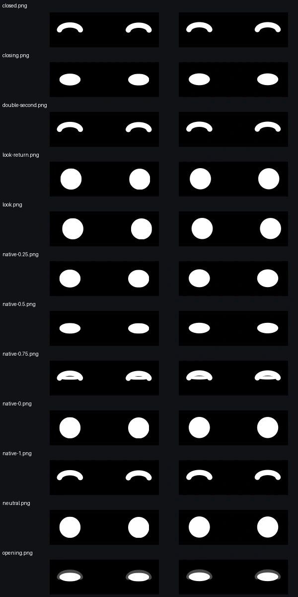

# Caretas do Kiwi-cat

T8959 · spec Kiwi #8758, versão aprovada #8870 · issue [#392](https://github.com/kiwi-init/kiwinotes/issues/392).

Demonstração isolada dos oito estados com olhos e símbolos vetoriais sobre a
névoa B1. Cabeça, corpo e orelhas permanecem imóveis. Não há importação do módulo
nas telas do app. O relógio, o sorteio e o tempo até dormir são injetáveis.


## Vídeos

Capturas do WebKit headless, na cor padrão, sem áudio. A voz em `ouvindo` é
uma sequência de números sintéticos; nenhum microfone é acessado. São provas
visuais e não servem para medir CPU ou cadência.

| Estado | Vídeo |
| --- | --- |
| Repouso | [16 s, piscadas e olhar](videos/repouso.mp4) |
| Dormindo | [zZ em movimento](videos/dormindo.mp4) |
| Acordou | [reação inicial](videos/acordou.mp4) |
| Ouvindo | [nível de voz sintético](videos/ouvindo.mp4) |
| Thinking | [busca e pontos](videos/thinking.mp4) |
| Agindo | [gotas e linhas](videos/agindo.mp4) |
| Pronto | [reação e retorno ao repouso](videos/pronto.mp4) |
| Erro | [traçado do rabisco em loop](videos/erro.mp4) |

O quadro de Reduzir movimento usa os três arcos brancos da referência de
`ouvindo`. Com `voz=null` ou ausente, as ondas desaparecem no mesmo quadro,
inclusive durante a troca de símbolo. A animação normal mantém a onda com alfa
0,35 no silêncio numérico e aumenta as ondas pelas faixas do roteiro.

O lead reconheceu os oito estados na tira corrigida sem legenda (Kiwi #9077,
conferido em #9079) e aprovou a comparação de formas (#9078). O aceite visual
do harry será registrado depois de ele ver os vídeos.

## Verificação

Em `app/`:

```sh
bun test
bun run typecheck
bun scripts/kiwicat-face-check.ts /tmp/kiwi-T8959-render
bun scripts/kiwicat-face-videos.ts
# Pillow in an isolated environment; keeps the answer key outside the repo:
python scripts/kiwicat-face-sheet.py /tmp/kiwi-T8959-render --key /tmp/kiwi-T8959-key.json
```

O check funcional percorre os oito estados, WebGPU/WebGL2/sem GPU,
quadro parado, voz ausente, ocultação, retomada e descarte. O vídeo nativo de
repouso permite conferir os gestos programados no compositor sem forçar RAF
no shader: a névoa continua a duas atualizações por segundo.

Para CPU, obter primeiro `kiwi lock bench --wait 30m`. Fechar apenas os processos
headless da própria execução e não gravar nem rodar outros checks durante a coleta.

```sh
bun scripts/kiwicat-face-bench.ts /tmp/kiwi-T8959-fog 2 --fog-only
bun scripts/kiwicat-face-bench.ts /tmp/kiwi-T8959-faces 2
```

A coleta de aceite usa 12 pares alternados, conforme o protocolo abaixo. Cada execução aquece por 10 segundos e
mede por 60 segundos, congelando os cinco PIDs do seu WebKit. Os relatórios
registram CPU por processo e hashes dos arquivos da implementação. O alvo é
até +0,5 ponto de CPU em repouso e pelo menos 55 fps nos estados ativos.
As medidas são da página isolada no Playwright WebKit, não do WKWebView do app.

A primeira sondagem, anterior à otimização de pausas dos gestos, está em
[diagnostico-inicial/](diagnostico-inicial/). Ela falhou no teto de CPU e não
é resultado de aceite. As medidas finais serão anexadas após a coleta pareada.

## CPU: primeira série de 12, acima do teto

Head medido `45a0f21`. CPU em percentual de um núcleo, por cinco processos
próprios do WebKit; 10 s de aquecimento e 60 s de coleta por variante.
Amostras sem vídeo, com hashes dos nove arquivos de runtime em cada JSON.

| Par | Ordem | Névoa | Caretas | Delta (ponto) | Carga início→fim | Variação | Estável |
| --- | --- | ---: | ---: | ---: | ---: | ---: | --- |
| 1 | fog→faces | 1.914551 | 2.580920 | +0.666369316 | 3.916→3.866 | 1.297 | sim |
| 2 | faces→fog | 2.081407 | 2.580680 | +0.499273508 | 3.866→4.549 | 1.412 | sim |
| 3 | fog→faces | 2.247531 | 2.531656 | +0.284124406 | 4.549→3.125 | 1.683 | não |
| 4 | fog→faces | 2.064126 | 3.180825 | +1.116699335 | 3.125→3.232 | 1.670 | não |
| 5 | fog→faces | 2.447306 | 2.830166 | +0.382859709 | 3.232→4.882 | 3.482 | não |
| 6 | fog→faces | 2.581350 | 3.096341 | +0.514991225 | 4.882→3.412 | 2.190 | não |
| 7 | fog→faces | 2.364167 | 2.847319 | +0.483152296 | 3.412→7.586 | 4.631 | não |
| 8 | faces→fog | 2.247513 | 2.946541 | +0.699027817 | 5.429→3.510 | 2.110 | não |
| 9 | fog→faces | 2.313992 | 3.129771 | +0.815778813 | 3.510→2.414 | 1.848 | não |
| 10 | faces→fog | 2.447138 | 3.129533 | +0.682394886 | 2.414→3.088 | 1.100 | sim |
| 11 | fog→faces | 2.230953 | 3.196252 | +0.965299005 | 3.088→3.028 | 1.543 | não |
| 12 | faces→fog | 2.530500 | 3.229419 | +0.698918788 | 3.028→3.159 | 1.474 | sim |

**Mediana de todos: +0.674382100875815. Mediana dos 4 estáveis: +0.674382100875815.**
Faixa: +0.284124406 a +1.116699335. **Reprovado no teto de +0,5.**
[Dados integrais](desempenho/serie-12-pares.json).

O protocolo mudou durante a coleta (Kiwi #9209). Os primeiros seis pares
preservam as ordens originais, incluindo as repetições antigas de névoa→caretas.
Os seis finais, 7–12, alternam a ordem. Todos os 12 contam, incluindo os
quatro inicialmente descartados por carga. A classificação estável usa
variação ≤1,5; as amostras intermediárias estão no JSON. O registro da fase
anterior fica em `fase1-antes-da-regra12.json`; o probe interrompido na troca
de protocolo está em `protocolo-interrompido/` e não conta como par completo.

O critério final é: ambas as medianas ≤+0,5. O lead pediu uma única rodada
de otimização, seguida de outra série de 12; o resultado dessa última série
será anexado sem nova tentativa para forçar aprovação (Kiwi #9221).

## Diagnóstico sem gestos

[Dados](desempenho/sem-gestos/resumo.json): névoa 3,4027445061%,
olhos imóveis 3,3530790216%, delta **−0,0496654846 ponto**, perto de zero.
São 12 janelas de 5 s por variante, ~60,8 s somados, seed fixa 386. Cada
janela termina antes da primeira piscada (8,994 s) e do olhar (11,625 s).
Os olhos ficaram com `faceUpdates` 1→1, `quietPlans=0` e zero animações; a
névoa fez dez desenhos por janela. Não foi usado `parado`. Esse protocolo
de contextos novos localiza o custo; o aceite usa as janelas contínuas de 60 s.

## Perfil e única otimização final

[Perfil anterior à mudança](desempenho/gestos-isolados-45a0f21/resumo.json),
quatro ocorrências naturais por gesto/variante, névoa descontada:

| Gesto | CPU líquida por ocorrência |
| --- | ---: |
| Piscada simples | 82,5 ms |
| Olhar lateral | 75,0 ms |
| Piscada dupla | 152,5 ms |

O contador do `ps` tem resolução de 10 ms. A névoa manteve 2/s durante
esses gestos. A piscada dupla é a mais cara; o par de olhos do repouso agora
compartilha suas camadas de disco e arco. Uma piscada usa dois efeitos
nativos em vez de quatro. Tempos, sorteios e trajetórias da máquina não mudam.
Os olhos individuais continuam disponíveis para as demais expressões.



[Comparação](desempenho/otimizacao-piscar/pixel-diff.json): os sete outros
estados são idênticos pixel a pixel; as diferenças dos olhos em repouso
ficam nas bordas suavizadas (média ≤0,087/255 por canal nas poses verificadas).
O comparador nativo confirmou quatro efeitos antes e dois depois.

## Quadros por segundo

[Check dentro da página](desempenho/fps-por-estado.json): 59,88–60,06 fps
em névoa e vetores. Em `pronto`, a amostra foi de 101 a 802 ms após entrar
no estado (701 ms), antes do retorno automático em 1,1 s: 59,89 fps.
Os demais estados tiveram 1 s de assentamento e 3 s de amostra.
Nenhuma janela trocou de estado. A medição de FPS não inclui sondagem de
processos entre o começo e o fim da janela.

Para repetir em diretórios novos, com o lease `bench` e fonte congelada:

```sh
python3 scripts/kiwicat-face-series.py /tmp/kiwi-T8959-serie-nova
bun scripts/kiwicat-face-no-gesture.ts /tmp/kiwi-T8959-sem-gestos-novo
bun scripts/kiwicat-face-gesture-profile.ts /tmp/kiwi-T8959-perfil-novo
```

A medição é da demonstração no Playwright WebKit, não do WKWebView do app.
