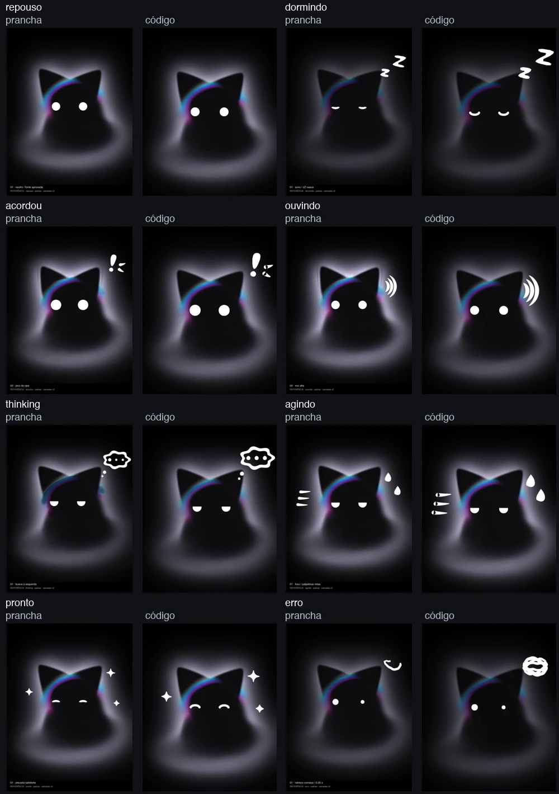
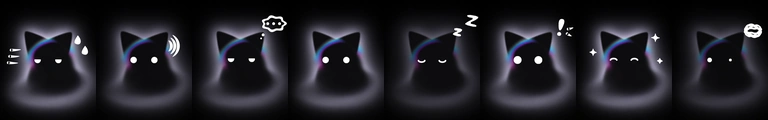

# Caretas do Kiwi-cat

T8959 · spec Kiwi #8758, versão aprovada #8870 · issue [#392](https://github.com/kiwi-init/kiwinotes/issues/392).

Demonstração isolada dos oito estados com olhos e símbolos vetoriais sobre a
névoa B1. Cabeça, corpo e orelhas permanecem imóveis. Não há importação do módulo
nas telas do app. O relógio, o sorteio e o tempo até dormir são injetáveis.





## Vídeos

Capturas do WebKit headless, na cor padrão, sem áudio. A voz em `ouvindo` é
uma sequência de números sintéticos; nenhum microfone é acessado. São provas
visuais e não servem para medir CPU ou cadência.

| Estado | Vídeo |
| --- | --- |
| Repouso | [16 s, piscadas e olhar](videos/repouso.mp4) |
| Dormindo | [zZ em movimento](videos/dormindo.mp4) |
| Acordou | [reação inicial](videos/acordou.mp4) |
| Ouvindo | [nível de voz sintético](videos/ouvindo.mp4) |
| Thinking | [busca e pontos](videos/thinking.mp4) |
| Agindo | [gotas e linhas](videos/agindo.mp4) |
| Pronto | [reação e retorno ao repouso](videos/pronto.mp4) |
| Erro | [traçado do rabisco em loop](videos/erro.mp4) |

O quadro de Reduzir movimento usa os três arcos brancos da referência de
`ouvindo`. Com `voz=null` ou ausente, as ondas desaparecem no mesmo quadro,
inclusive durante a troca de símbolo. A animação normal mantém a onda com alfa
0,35 no silêncio numérico e aumenta as ondas pelas faixas do roteiro.

O lead reconheceu os oito estados na tira corrigida sem legenda (Kiwi #9077,
conferido em #9079) e aprovou a comparação de formas (#9078). O aceite visual
do harry será registrado depois de ele ver os vídeos.

## Verificação

Em `app/`:

```sh
bun test
bun run typecheck
bun scripts/kiwicat-face-check.ts /tmp/kiwi-T8959-render
bun scripts/kiwicat-face-videos.ts
```

O check funcional percorre os oito estados, WebGPU/WebGL2/sem GPU,
quadro parado, voz ausente, ocultação, retomada e descarte. O vídeo nativo de
repouso permite conferir os gestos programados no compositor sem forçar RAF
no shader: a névoa continua a duas atualizações por segundo.

Para CPU, obter primeiro `kiwi lock bench --wait 30m`. Fechar apenas os processos
headless da própria execução e não gravar nem rodar outros checks durante a coleta.

```sh
bun scripts/kiwicat-face-bench.ts /tmp/kiwi-T8959-fog 2 --fog-only
bun scripts/kiwicat-face-bench.ts /tmp/kiwi-T8959-faces 2
```

Repetir três pares alternando a ordem. Cada execução aquece por 10 segundos e
mede por 60 segundos, congelando os cinco PIDs do seu WebKit. Os relatórios
registram CPU por processo e hashes dos arquivos da implementação. O alvo é
até +0,5 ponto de CPU em repouso e pelo menos 55 fps nos estados ativos.
As medidas são da página isolada no Playwright WebKit, não do WKWebView do app.

A primeira sondagem, anterior à otimização de pausas dos gestos, está em
[diagnostico-inicial/](diagnostico-inicial/). Ela falhou no teto de CPU e não
é resultado de aceite. As medidas finais serão anexadas após a coleta pareada.
