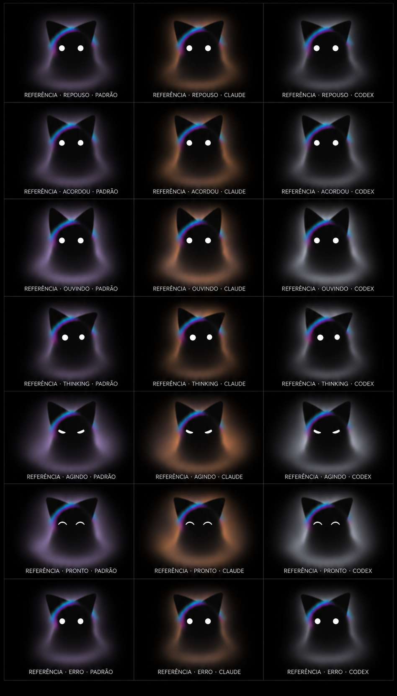

# Prancha dos estados — T7606

Spec #7591 do canal `kiwinotes`, aprovado pelo harry; instrução #7589.
Issue: https://github.com/kiwi-init/kiwinotes/issues/309.

**Referências conceituais geradas, não capturas da animação. Aprovação visual pendente.**

## Leitura

As linhas são `repouso`, `acordou`, `ouvindo`, `thinking`, `agindo`, `pronto`
e `erro`. As colunas são padrão (lilás), Claude Code (laranja) e Codex
(branco perolado). Há uma pose por estado e paleta, sobre preto.

| Estado | Intenção da pose |
| --- | --- |
| repouso | Olhos abertos e névoa discreta |
| acordou | Atenção breve, orelhas erguidas e névoa ampliada |
| ouvindo | Atenção frontal e luz próxima do corpo |
| thinking | Olhar deslocado e concentração junto à cabeça |
| agindo | Olhos semicerrados e iluminação lateral mais ampla |
| pronto | Piscada satisfeita, orelhas relaxadas |
| erro | Hesitação sutil e névoa contraída, sem susto |

## Origem e arquivos

A ferramenta integrada `image_gen` recebeu **a v2 aprovada como imagem de
entrada**, `../gerada/kiwi-cat-candidata-v2.png`. O prompt integral está em
`prompt-prancha.txt`. A saída nativa foi preservada em `prancha-estados.png`
(948 × 1659 pixels), sem ampliação nem retoque.

Os 21 PNGs de `quadros/` são recortes mecânicos dessa mesma geração, feitos
com `sips --cropToHeightWidth H W --cropOffset Y X`, sem reamostragem.
Cada `.txt` contém o prompt integral e identifica a célula correspondente;
não são 21 gerações independentes. `quadros.json` registra as coordenadas.
Todos os quadros mantêm a legenda de referência.

`INSTRUCAO.md` preserva a instrução completa entregue na T7606, incluindo a
regra atualizada do Electrobun Livewire autorizada no #7590.

## Conferência e decisão visual

Foram conferidos o grid 7 × 3, os 21 recortes, as legendas, os prompts e a
separação das paletas. O aro permanece ciano a púrpura nas três colunas;
não há cauda, adereços nem mudança intencional de personagem.

A geração é uma proposta visual, sujeita a variação de pixels. **Ela não
comprova a tolerância de 4/255 da composição por camadas**, que será exigida
na implementação, nem comprova movimento ou desempenho. A v2 continua sendo
a fonte da verdade, e estes quadros não serão usados como sprites no app.

Pontos para o lead levar ao harry: a expressão de `agindo` pode ler como
severa; `erro` é deliberadamente discreto; a leitura de névoa e a diferença
entre `repouso`, `acordou` e `ouvindo` precisam do julgamento visual dele.

Nenhum arquivo do app foi alterado. Não foram abertos app, janela ou
microfone. Não há shader, roteiro de movimento ou teste de desempenho nesta
entrega. A próxima entrega espera o ok do harry na prancha.
