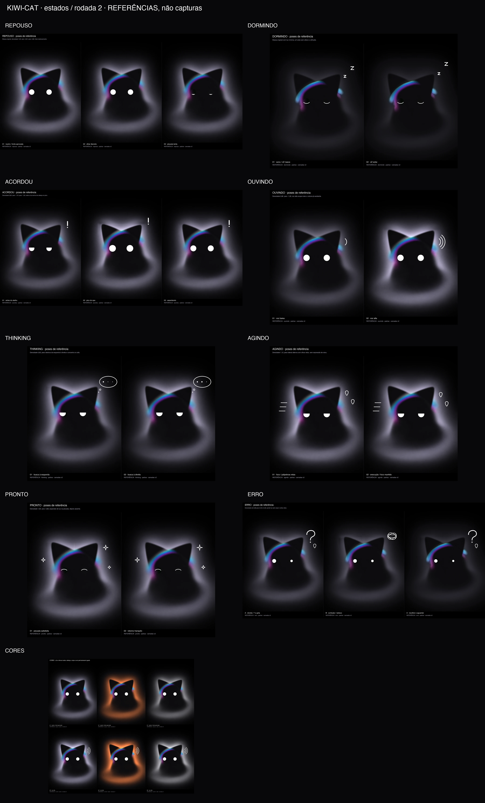

# Estados do Kiwi-cat — T7606

Spec #7591; instrução #7589; revisão #7630; adendo do harry #7649 entregue
pelo lead no #7655, corrigido no #7657 e aprovado no #7671, no canal `kiwinotes` do Kiwi Channels.
Issue [#309](https://github.com/kiwi-init/kiwinotes/issues/309), PR [#311](https://github.com/kiwi-init/kiwinotes/pull/311).

**Referências documentais compostas com as camadas originais, não capturas da animação. Prancha aprovada pelo harry (#8276), conforme o spec #7591, versão #8293.**



Revisões #7713 e #7832: aro acompanha a luz, símbolos de quadrinho em formas cheias
e cor livre por agente. A decisão posterior #7718/#7724 escolheu o rabisco (B), removeu a opção A
e pediu orelhas com movimento amplo.

## Imagens grandes

Cada pose usa um palco de 1536 × 1920, mais 132 pixels de legenda. A fonte
2048 × 2560 é reduzida uniformemente a 75%, sem alteração das proporções.
O gato, das orelhas ao fim do corpo, ocupa mais de 1024 pixels de altura.
Abra as imagens de estado no tamanho original para julgar o detalhe;
o resumo é só navegação. Cada WebP tem no máximo 500.000 bytes.

A [tira de tamanho real](tamanho-real.webp) mostra os oito estados lado a
lado, com altura de referência do gato de 120 e 240 px (marcas verticais).
A escala usa os mesmos pontos da v2, y=650 a y=2240 na fonte, em todos
os estados; símbolos e margens não entram nessa medida. Veja a 100% de zoom.

| Imagem | Poses e olhos | Símbolo e intenção |
| --- | --- | --- |
| [repouso](estado-repouso.webp) | Neutro, olhar discreto, piscada lenta | Sem símbolo; comportamento discreto |
| [dormindo](estado-dormindo.webp) | Dois momentos de sono, arcos para baixo | zZ subindo; névoa mínima |
| [acordou](estado-acordou.webp) | Antes, pico com olhos 24% maiores, assentando | Exclamação só no pico (02), ausente antes e assentando; pulso de luz |
| [ouvindo](estado-ouvindo.webp) | Voz baixa e alta, olhos redondos | Uma e três ondas junto da orelha; a névoa acompanha a voz |
| [thinking](estado-thinking.webp) | Semicerrados, olhar para cima e para cada lado | Balão de três pontos, um e dois pontos acesos; luz concentrada no alto |
| [agindo](estado-agindo.webp) | Foco e execução, pálpebras superiores horizontais | Gotas de suor e linhas de movimento; luz lateral alterna |
| [pronto](estado-pronto.webp) | Dois momentos de arco feliz | Brilhos que abrem; névoa assenta |
| [erro](estado-erro.webp) | Olhos menores e desiguais; orelhas assimétricas | Rabisco começando (0 s), no meio (0,45 s) e embolado (0,90 s) |
| [cores](cores.webp) | Repouso e voz alta × três paletas | Lilás, laranja, perolado, verde, rosa, azul e quase preto com piso |

São **19 poses padrão e doze variações adicionais de cor**. Os parâmetros
por pose estão em `quadros.json` e nos `.txt` junto dos quadros soltos.
São poses documentais, não um roteiro temporal nem prova de animação fluida.

## Construção

A revisão #7630 pediu composição por script em vez de geração do personagem.
`montar.py` usa literalmente `luz.png`, `corpo.png`, `cabeca.png`, as duas
orelhas e `aro.png`, para recompor a cena aprovada antes de preparar as bases ocultas. As orelhas giram pela base,
nos pivôs originais. Corpo, cabeça e aro não recebem deformação, rotação ou
translação; só a escala global de apresentação.

As pálpebras horizontais, círculos, arcos e símbolos são desenhados por código
com supersampling 2× e redução Lanczos. Os olhos fechados mantêm 34 px na fonte. Os símbolos são formas cheias
com espessura variável e leve irregularidade determinística, desenhadas por
curvas e polígonos: cunha inclinada com ponto e ênfases no `!`, gancho
inclinado no `?`, zZ gordos, nuvem bojuda, estrelas cheias, gotas gordas,
ondas e velocidade afuniladas. Nenhum símbolo usa glifo de fonte. São
brancos, com pontas suavizadas, fora da silhueta, sem cobrir olhos ou aro. Não há
notebook, livro, lupa nem logotipo. O desenho segue a tabela aprovada do adendo;
a v2 é a única fonte visual do personagem.

Quando a pálpebra fecha ou o olhar desloca, o script estima somente os pixels
antes ocultos pelos olhos (discos + 5 px), por interpolação harmônica com a borda
vizinha fixa. A piscada lenta mantém os arcos brancos no fechamento, sem modificar as texturas de origem.

A névoa mantém a massa orgânica da v2. Não há anel, partícula, forma sintética,
blur ou nova geração por IA. Densidade, peso lateral/vertical e matiz são
aplicados **à névoa visível depois da composição**, preservando a silhueta
fosca e a matiz do aro. Assim, reduzir a luz não expõe os cortes retos da
separação antiga de `luz.png`. A pose neutra padrão não recebe esse ajuste.
A distribuição de densidade e a intenção de direção aparecem nas legendas.
A exposição mínima da névoa é 0,50 da v2, inclusive no sono: ela perde luz,
mas mantém o contorno da cabeça e das orelhas. O ganho do aro é o menor ganho
local da névoa, limitado a 1: ele cai junto da luz, sem se tornar neon mais
forte em relação à névoa. Seu ciano/púrpura é preservado. A pose neutra padrão
continua sem alteração.

`cor` aceita cores sRGB via `ImageColor` (por exemplo, qualquer `#RRGGBB`).
Se a luminância linear da entrada for menor que 0,28, a preparação eleva a
cor em direção ao branco até esse piso, preservando a direção de matiz.
A cor é normalizada para iluminar a mesma massa de névoa; os olhos e símbolos
não recebem a cor do agente. Em `cores.webp`, duas linhas (repouso e voz alta)
mostram sete opções: padrão, Claude, Codex, verde `#63d997`, rosa `#ff81c0`,
azul `#70a8ff` e quase preto `#030409`. A folha é reduzida uniformemente para
9856 px de largura, com o gato ainda acima de 1024 px de altura por célula.
A escolha em Ajustes foi registrada na seção 4 da instrução; este PR continua
somente documental, sem implementar a tela de Ajustes.

## Limite das orelhas nesta entrega

O spec #7591, versão #8293 aprovada pelo harry, encerra esta entrega com o
limite medido das camadas estáticas da v2: **±5°**. O alvo de **±25°**, com
`erro` perto de ±20°, passa para a entrega do gato em código. Não é uma
redução do movimento final pedido pelo harry.

A [prova de orelhas](prova-orelhas.webp) mostra cada uma sozinha em −5°,
−2,5°, 0°, +2,5° e +5°. Amplitudes maiores expuseram a luz e o aro gravados
com a orelha neutra; as tentativas e medidas estão em [experimentos/](experimentos/README.md).

A orelha gira como uma
peça quase rígida em torno
do pivô; somente a faixa da base (80 px acima a 60 px abaixo do pivô, na
fonte) flexiona. A largura, o comprimento e a ponta do triângulo ficam fora
dessa faixa. Não há mais a deformação distribuída na borda interna ou por
quase toda a orelha. A cabeça entre as orelhas permanece fixa.
`erro` abre de forma assimétrica, até +3° à esquerda e −2° à direita; nenhuma pose ou prévia usa ±30°.
A folha é reduzida globalmente para 7040 px de largura; a altura do gato por
célula continua acima de 1024 px.

As quatro texturas derivadas em `preparadas/` são PNGs de preparação sem
perda, 2048 × 2560: fundo sem orelhas, cabeça fixa e as duas orelhas RGBA.
Não são imagens de revisão em WebP. Os seis arquivos em `gerada/` permanecem
intactos. A extração anterior misturava parte da silhueta das orelhas na luz
e no aro; girar apenas aqueles recortes deixava um fantasma no fundo.

O script recompõe primeiro a cena original e refaz a separação de alfa
somente nas regiões das orelhas. O fundo revelado recebe interpolação
harmônica, com suavização apenas no fundo oculto. O recorte móvel abrange
a superfície escura e uma faixa estreita de antialias ao redor; a névoa ampla
fica fixa. Alfa e RGB são resolvidos pela equação source-over,
para preservar a imagem neutra. A luz residual fica no fundo imóvel; não
há corte vertical de propriedade entre orelhas, mas uma transição suave. Uma placa fixa conserva os pixels da cabeça e do aro frontal; a extensão
antes escondida da cabeça usa uma máscara contínua, sem as pontas recortadas
da separação antiga. Nas bases **completamente ocultas** por
essa placa, o alfa faltante é continuado em RGBA premultiplicado,
com interpolação em ponto flutuante e RGB preto fosco. Isso evita carregar uma segunda cópia
do aro para fora da cabeça ou expor um recorte opaco plano.

A preparação não redesenha os pixels visíveis do gato: a comparação neutra
é a conferência decisiva (máximo 2/255 e média próxima de 0,0434/255 fora dos
olhos), antes de reduzir/comprimir. A invariância é da composição visível,
não dos canais RGBA da separação antiga, que foram reorganizados. Fora da
região de preparação o fundo é preservado exatamente; cabeça e corpo não
recebem transformação. A comparação neutra valida apenas a referência parada; não valida
o alvo de ±25° da futura entrega em código. `verificacao.json` registra o método,
a região alterada e as métricas; `preparadas/manifest.json` guarda o contrato.

O repouso demonstra um tique unilateral, o sono relaxa as duas orelhas, o
acordar as ergue, a escuta vira para o som e o erro abre suavemente até +3°/−2°.
Na futura animação, os tiques são independentes, as piscadas são lentas e às
vezes duplas, com intervalos variáveis. As três prévias abaixo demonstram
movimento; continuam sendo documentos, sem código do app.

## Prévias de movimento — não são a animação final

| Estado | Duração | WebP animado | Cópia para anexar |
| --- | --- | --- | --- |
| repouso | 6 s | [WebP](previas/repouso.webp) | [MP4](previas/repouso.mp4) |
| acordou | 2,4 s | [WebP](previas/acordou.webp) | [MP4](previas/acordou.mp4) |
| erro | 3 s | [WebP](previas/erro.webp) | [MP4](previas/erro.mp4) |

Todas usam **30 fps**, quadro 620 × 856 e altura de referência do gato de
aproximadamente 481 px. Cada WebP animado tem até 1,5 MB. O rodapé de todos os
quadros diz “prévia de movimento, não é a animação final” e mostra o número
do quadro. O contador também preserva quadros repetidos na cadência de 30 fps.

`repouso` mostra uma piscada lenta, só a orelha direita dando um tique e o
olhar para o lado; `acordou` mostra olhos e orelhas erguendo, `!` saltando e
sumindo ao assentar; `erro` mostra as orelhas abrindo e o rabisco sendo traçado,
embolando e recomeçando em cerca de 1 s, com leve tremida. A **névoa fica
parada** nos três clipes: o shader e o movimento dela são da entrega 3.

Os `.json` de `previas/` registram os parâmetros por quadro e o manifest
registra duração, resolução, fps e pesos dos arquivos. A cópia MP4 usa H.264,
sem áudio. A inspeção headless usa quadros de contato e os metadados; o
julgamento do movimento é do harry. Tema claro e animação final continuam
fora desta entrega.

**Tema claro permanece em aberto:** o ícone e os símbolos brancos foram
preparados para fundo escuro. A solução para o tema claro precisa de decisão
visual própria; esta prancha não decide contorno, fundo ou inversão de cor.

`INSTRUCAO.md` preserva a instrução completa e seu novo adendo (seção 9).
`prompt-prancha.txt` é o registro histórico da rodada 1 rejeitada; nenhum
quadro daquela geração é usado aqui. Os `.txt` atuais descrevem a composição
real, sem fingir que houve prompts de IA nesta rodada.

## Reprodução e conferência

```sh
python3 -m venv /tmp/kiwi-cat-estados
/tmp/kiwi-cat-estados/bin/pip install -r docs/brand/kiwi-cat/gerada/requirements.txt
/tmp/kiwi-cat-estados/bin/python docs/brand/kiwi-cat/estados/montar.py
```

A geração das prévias também usa `ffmpeg`/`ffprobe` locais. `--stills-only`
refaz só as folhas; `--previews-only` refaz só os clipes. A exportação usa
dois threads no encoder e não abre app ou janela.

Também foram conferidos pixels sintéticos: uma névoa cinza de 120/255
reduzida para 66/255 e um aro ciano reduzido exatamente à metade; o matte
(11,11,14) permanece igual e o caso quase preto continua luminoso.

O script confere a composição neutra na resolução da fonte, **antes da redução
e da compressão WebP**, contra a v2: máximo ≤4/255 e média <0,5/255 fora dos
discos dos olhos com margem de 5 px. Os números e os hashes das seis camadas
estão em `verificacao.json`. A tolerância cobre só essa pose, não as orelhas
giradas, as variações de luz ou o WebP com perdas. As poses alteradas e a
compressão precisam também de inspeção visual.

Os oito estados, a prova de orelhas, a imagem de cores, o resumo e a tira de
tamanho real são WebP estáticos de até 500 KB cada. As três prévias animadas
têm limite separado de 1,5 MB por WebP.
O script prepara só documentos: nada do app, shader, overlay, microfone ou
interface do macOS é executado. O ok do harry continua necessário antes da
entrega seguinte.

## O que a entrega em código precisa resolver

A luz e o aro da v2 incluem a franja das orelhas na posição neutra. Não basta
rotacionar esses pixels. A tentativa corrigida de #7963 calculou o halo
inteiro, ajustou quatro escalas por mínimos quadrados e desfez o resíduo
perto das orelhas nos primeiros 3°; ainda falhou. Em `E > 0,1`, o resíduo teve
média **13,998/255** e máximo **34,903/255**. A nova extração de superfícies
opacas também falhou na recomposição neutra (máximo 119/255), e o aro
original repôs a franja antiga por cima das orelhas movidas. Esses números
são do experimento rejeitado, não da prancha aprovada.

A entrega em código precisa separar a superfície fosca da luz, desenhar a
névoa e o aro ao vivo, resolver a oclusão nas bases e provar cada orelha em
±25° e o erro em ±20°, sem linha antiga, faixa na junção ou luz dentro da
orelha. Os olhos, a piscada, os símbolos, o rabisco, as cores e o desenho do
aro aprovados permanecem a referência visual. O tique das prévias desta
entrega é −4° só à direita; o erro usa +3°/−2°.

A composição principal continua batendo com a v2: máximo **2/255**, média
**0,043514/255**, fora dos discos dos olhos +5 px, em 2048 × 2560. As seis
fontes originais permanecem intactas. Esta entrega não altera o app nem
antecipa roteiro, shader ou implementação do gato.
