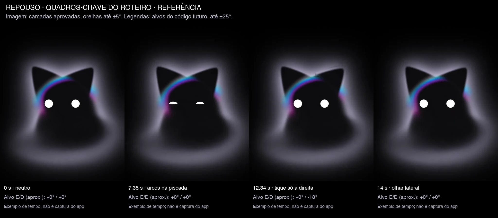
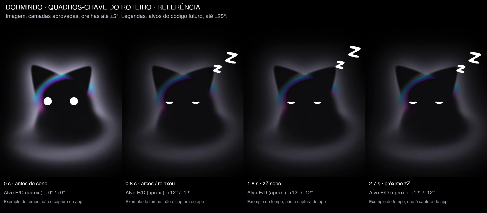
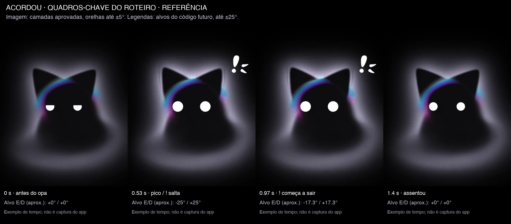
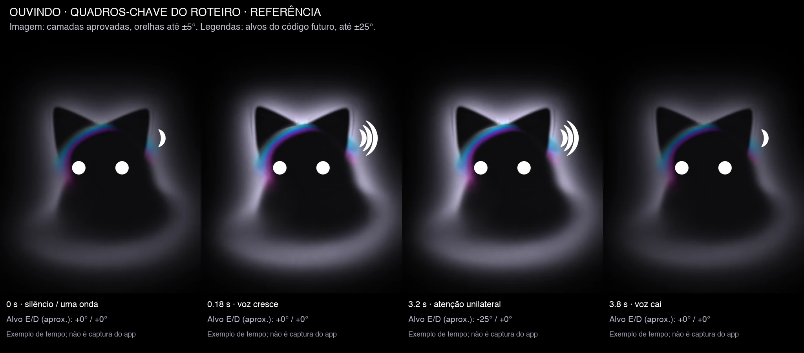
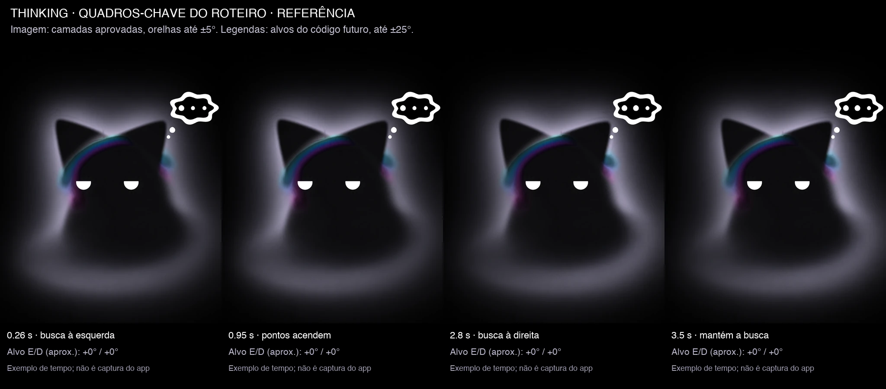
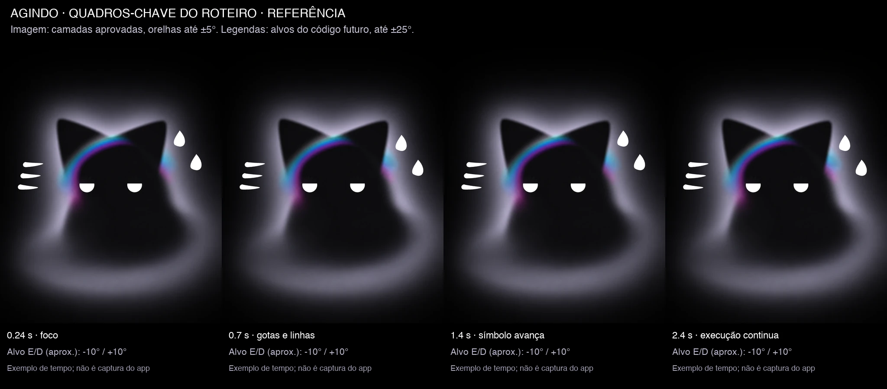
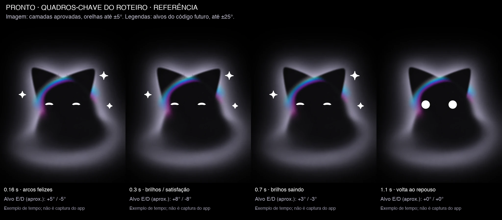
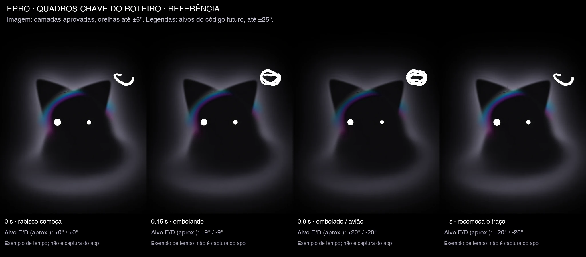

# Roteiro de movimento do Kiwi-cat

T8377 · spec aprovado #7718 (versão #8347) · issue [#372](https://github.com/kiwi-init/kiwinotes/issues/372).
**Proposta de tempos e curvas para revisão. Documento e imagens de referência; não é animação implementada.**

A prancha aprovada pelo harry (#8276) fixa olhos, símbolos, rabisco, aro e
cores. Este roteiro fixa como esses elementos se movem. A cabeça e o corpo
ficam imóveis, de frente, com proporções da v2; não respiram, não pulam e
não balançam. O aro conserva sua forma e matiz ciano–púrpura. Só a névoa
recebe a cor escolhida por agente.

O alvo do código é **cada orelha em −25° a +25°**, com `erro` perto de 20°
para fora. A decisão do lead #8295 limitou apenas as imagens estáticas a
±5°: elas carregam a luz e a franja do aro da pose neutra. Os diagnósticos
estão em [experimentos/](experimentos/README.md). Este roteiro não tenta
resolver essa extração, implementar shader ou mudar o app.

## Como ler as medidas

Todos os deslocamentos em `px-fonte` usam o palco original 2048 × 2560;
na apresentação, são multiplicados pela escala global. A posição e os
pivôs vêm de `gerada/manifest.json`. Ângulo zero é a orelha da v2. Positivo
é anti-horário: esquerda para fora = positivo; direita para fora = negativo.
Erguer para dentro usa esquerda negativa e direita positiva. Os limites
são individuais, nunca a soma das duas orelhas.

`A → B → A` indica ida, permanência e volta. Uma duração entre colchetes
é sorteada uniformemente **uma vez por gesto**, sem sorteio por quadro.
Amplitude e lado também são sorteados por gesto, quando houver faixa.
Amostras são independentes, com gerador e relógio controláveis nos testes;
o relógio usa tempo decorrido, não contagem de quadros. Não reiniciar os
sorteios por redesenho da interface nem repetir uma sequência a cada estado.

| curva | definição e uso |
|---|---|
| `suave` | `s(u) = 3u² − 2u³`, u limitado a [0,1]; ida/volta sem salto nas extremidades |
| `sair` | `1 − (1 − u)³`; entrada rápida do símbolo e desaceleração |
| `entrar` | `u³`; saída discreta de símbolo/overlay |
| `pulso` | `sin(πu)` para uma única subida e descida, sem repetição automática |
| `exponencial` | aproximação por tempo decorrido, com constante τ; usada na voz |
| `traçar` | avanço monotônico do traço aprovado, de 0 a 1; não sorteia outra forma |

Para juntar gestos, cada canal tem um único dono: olhos, orelha esquerda,
orelha direita, símbolo, névoa. A entrada de um estado cancela os gestos
incompatíveis e interpola **da pose corrente**, sem voltar primeiro ao
neutro. Nunca somar ângulos além de ±25°. Aro e névoa compartilham o ganho
de luz; não existe um pulso independente do aro.

## Gestos naturais e agendamento

Os nomes abaixo são os nomes estáveis que a futura máquina de estados e
seus testes devem usar. Não são funções do app nesta entrega.

| gesto | intervalo para começar | amplitude e fases | exclusão |
|---|---|---|---|
| `piscar_lento` | repouso: [4,5; 9,0] s após terminar a piscada anterior | fechar [240;320] ms, arco branco visível [60;100] ms, abrir [300;440] ms; total [600;860] ms | não começar durante entrada, saída ou outra piscada |
| `piscar_duplo` | probabilidade 18% após `piscar_lento` | segunda piscada após [120;220] ms; mesmas fases; só duas piscadas | sorteio uma vez, nunca uma cadeia de piscadas |
| `tique_orelha` | repouso: [7;16] s após terminar o tique anterior | escolher só um lado; 0 → [10;22]° para fora em [120;180] ms, segurar [50;100] ms, voltar em [220;360] ms, `suave` | outra orelha imóvel; esperar ≥600 ms entre tique e olhar |
| `olhar_lateral` | repouso: [6;14] s após terminar o olhar anterior | ambos os olhos juntos até ±[18;30] px-fonte; ida [180;260] ms, segurar [600;1500] ms, volta [260;360] ms | sem mover cabeça; esperar ≥600 ms entre olhar e tique |
| `relaxar_sono` | uma vez ao entrar em dormindo | esquerda +12°, direita −12°, em 700 ms, `suave` | sem tiques durante o sono |
| `erguer_orelhas` | uma vez ao entrar em acordou | esquerda −25°, direita +25° em 330 ms; segurar 190 ms; assentar em 680 ms | substitui tique, não soma com ele |
| `orientar_orelha` | ouvindo, entre [2,8;6,5] s após o anterior | escolher um lado; [12;25]° para dentro em 180 ms, segurar [350;700] ms, voltar em 360 ms | não infere direção do som: a entrada só contém nível de voz |
| `olhar_busca` | thinking: [1,5;3,5] s entre buscas | alternar lado ±30 px-fonte e subir 24 px-fonte; ida 260 ms, segurar [600;1100] ms, volta 320 ms | não acompanha o movimento do balão com a cabeça |
| `foco_execucao` | uma vez ao entrar em agindo | abertura dos olhos 0,60; olhar entre 0 e +10 px-fonte em 240 ms | sem pálpebra diagonal nem expressão de raiva |
| `satisfacao` | uma vez ao entrar em pronto | olhos em arcos felizes; orelhas +8°/−8° por 260 ms e retorno 420 ms | não dispara dupla piscada aleatória |
| `orelhas_aviao` | uma vez ao entrar em erro | esquerda +20°, direita −20°, em 700 ms, `suave`; manter | não tremer cabeça nem orelhas junto do rabisco |
| `rabisco_loop` | enquanto erro estiver ativo | o mesmo rabisco aprovado é traçado, embola e recomeça perto de 1 s | detalhes na tabela de erro; só o símbolo treme |

Cada agendador sorteia o próximo intervalo **depois do fim** do gesto.
Se olhar e tique vencerem juntos, executar o que venceu primeiro e adiar
o outro até cumprir os 600 ms. A piscada pode coexistir com uma névoa
lenta, mas o olhar fica parado durante seu fechamento. A segunda piscada
não muda o instante já sorteado para tique ou olhar.

## 1. Repouso

Só existe no app. Ao entrar, olhos e orelhas assentam por 240 ms antes de
armar os agendadores. Depois de um tempo sorteado de [75;120] s sem pedido
ou mudança de estado, entrar em `dormindo`. Interação que mantém o app em
repouso reinicia só o tempo de sono, sem forçar uma piscada.

| elemento | quanto e o que faz | duração / curva |
|---|---|---|
| olhos | redondos, tamanho 1; `piscar_lento`, às vezes `piscar_duplo`; `olhar_lateral` | tempos sorteados da tabela de gestos; arco do fechamento tem espessura aprovada de 34 px-fonte |
| orelhas | neutras, com `tique_orelha` unilateral até 22° | sorteio independente; a outra fica parada |
| aro | preso à cabeça, ganho de luz ≤1, matiz fixa | acompanha somente a exposição da névoa |
| névoa | exposição de referência 1, variação suave de ±0,05; deriva muito lenta | mudanças de alvo a cada [5;11] s, interpolação `suave` em [3;6] s; ruído futuro não deve ciclar |
| símbolo | nenhum | não aparece um símbolo para preencher o tempo |



## 2. Dormindo

Entra apenas a partir de repouso prolongado. Nenhum gesto sugere gravação
ou processamento. Pedido novo leva a `acordou`, sem exigir o fim do zZ.

| elemento | quanto e o que faz | duração / curva |
|---|---|---|
| olhos | arcos para baixo aprovados, sem fechar mais até sumir | interpolação em 600 ms, `suave`; depois fixos |
| orelhas | `relaxar_sono`: +12°/−12° | 700 ms, `suave`; depois fixas |
| aro | mesma forma e cor, brilho reduzido junto da névoa | ganho 0,50 em 800 ms, sem pulso |
| névoa | exposição 0,50; apenas deriva muito lenta | assentar em 800 ms; mudanças de alvo de deriva a cada [8;16] s |
| símbolo | zZ aprovado; sobe 120 px-fonte, desaparece e reaparece embaixo | ciclo sorteado [1,6;2,3] s; subida `suave`; alfa 0→1 nos primeiros 20%, 1→0 nos últimos 25% |



## 3. Acordou

Reação curta de “opa, estou ouvindo”. A sequência nominal dura **1,40 s**;
a atividade pode continuar em `ouvindo` antes disso conforme a regra de
interrupção. A abertura do microfone não é responsabilidade da animação.

| elemento | quanto e o que faz | duração / curva |
|---|---|---|
| olhos | abertura 0,65→1 e tamanho 1→1,24→1,10→1; mantém os dois círculos | abrir 0–350 ms; tamanho sobe 200–530 ms, assenta 720–1400 ms, `suave` |
| orelhas | `erguer_orelhas`, alvo −25°/+25°, depois 0°/0° | 200–530 ms subida, pico até 720 ms, retorno até 1400 ms |
| aro | ganho acompanha a luz, no máximo 1; não gira com orelha | mesmo envelope da névoa |
| névoa | exposição 0,82→1,16→1,02, com mais luz no alto (peso +0,16) | um pulso 200–1400 ms, `suave`; não deslocar uma imagem borrada |
| símbolo | ! aprovado salta 70 px-fonte, escala 0,35→1; pico sobe mais 28 px-fonte; some | entra 300–460 ms, `sair`; mantém até 970 ms; alfa→0 até 1200 ms, `suave` |



## 4. Ouvindo

Olhos redondos e atenção contínua. A voz muda a névoa e as ondas; as orelhas
fazem gestos próprios, sem bater a cada sílaba. Não há direção de voz na
entrada: não simular localização espacial que o módulo não recebeu.

| elemento | quanto e o que faz | duração / curva |
|---|---|---|
| olhos | redondos, tamanho 1; piscada lenta entre [6;11] s | mesmas fases aprovadas; sem dupla para evitar interrupção visual da escuta |
| orelhas | `orientar_orelha`, um lado por vez; até 25° para dentro | conforme tabela de gestos, sem acompanhar cada pico de voz |
| aro | ganho = mínimo entre 1 e exposição da névoa | mesmo envelope filtrado da voz; matiz fixa |
| névoa | exposição 0,66→1,26; volume de luz 1→1,16 | nível filtrado `y` definido abaixo; subida rápida, descida suave |
| símbolo | ondas aprovadas: de uma a três, abertas junto da orelha | faixas de y: <1/3, [1/3;2/3), ≥2/3; entrada/saída de cada onda em 100 ms, `suave`; uma onda em alfa 0,35 no silêncio |



## 5. Thinking

Mostra busca, não execução. Não alternar a identidade visual com `agindo`
a cada quadro ou passo técnico: o estado vem da atividade informada.

| elemento | quanto e o que faz | duração / curva |
|---|---|---|
| olhos | abertura 0,58, 24 px-fonte acima; `olhar_busca` entre lados | [1,5;3,5] s entre gestos; sem semicerrar em diagonal |
| orelhas | neutras; um tique discreto de um lado em [6;12] s, amplitude [8;14]° para fora | ida 180 ms, segurar 80 ms, volta 360 ms, `suave`; suspender durante busca |
| aro | fixo; ganho acompanha a exposição mínima local da névoa | não pulsa com os pontos |
| névoa | exposição 0,95; peso lateral de −0,28 a +0,28 e alto +0,20 | troca de alvo a cada [2,5;5] s, interpolação em [1,6;2,4] s, `suave` |
| símbolo | balão aprovado com …; três pontos acendem um por vez, sem mover o balão sobre o aro | cada avanço [320;460] ms; alfa dos pontos 0,35→1 em 100 ms; manter a mesma forma do balão |



## 6. Agindo

Foco estável durante execução. Suor e linhas não significam esforço do
corpo; só o símbolo se move. Não usar tremor ou esticar o gato.

| elemento | quanto e o que faz | duração / curva |
|---|---|---|
| olhos | `foco_execucao`, abertura 0,60, pálpebras horizontais | assentar em 240 ms; manter |
| orelhas | leve atenção: −10°/+10°; sem tique enquanto símbolo estiver entrando | assentar em 320 ms, `suave` |
| aro | forma e matiz fixas; ganho no máximo 1 | segue a luz local, sem giro |
| névoa | exposição 1,12; peso lateral alterna entre ±0,12 | alvos sorteados a cada [2;4] s; transição 1,4 s, `suave` |
| símbolo | gotas e linhas aprovadas; gotas descem até 24 px-fonte, linhas avançam até 30 px-fonte | ciclos [650;950] ms, fase sorteada por grupo; alfa some nos últimos 160 ms e reaparece, sem mudar o desenho |



## 7. Pronto

Uma reação por conclusão, nominalmente **1,10 s**; não repetir se o mesmo
estado for informado novamente sem sair dele. Após a reação, app volta a
repouso e overlay sai. Pedido novo pode interromper a reação.

| elemento | quanto e o que faz | duração / curva |
|---|---|---|
| olhos | arcos felizes aprovados | formar em 160 ms, manter até 700 ms, abrir até 1100 ms, `suave` |
| orelhas | `satisfacao`: +8°/−8° e retorno ao neutro | ida 260 ms, manter até 420 ms, voltar até 840 ms |
| aro | acompanha exposição sem ganho relativo | máximo 1; não brilha sozinho |
| névoa | exposição 1,06→0,96; abre o volume de luz até +8% e assenta | pulso único em 900 ms |
| símbolo | estrelas cheias aprovadas, sem novos brilhos de outra forma; escala 0,75→1→0,85 | entram 120–300 ms, `sair`; saem em alfa entre 700–1100 ms, `suave` |



## 8. Erro

Só o rabisco B aprovado. As orelhas abrem em avião e mantêm o triângulo
reconhecível. Não usar a antiga opção de interrogação, susto ou shake.
No app, manter até novo estado informado; não fingir sucesso após um tempo.
No overlay, mostrar por pelo menos 2,2 s e sair se não houver pedido novo.

| elemento | quanto e o que faz | duração / curva |
|---|---|---|
| olhos | tamanho esquerdo 0,72; direito 0,72×0,62; redondos e desiguais | assentar em 200 ms, `suave`; sem piscar enquanto o rabisco nasce |
| orelhas | `orelhas_aviao`: +20°/−20°, segurar enquanto erro | 120–820 ms, `suave`; sem achatar triângulos nem mexer cabeça |
| aro | acompanha a névoa escurecendo, matiz fixa | ganho 0,68→0,50 em 700 ms |
| névoa | exposição 0,68→0,50; mantém silhueta legível | 700 ms, `suave`; não apagar o gato |
| símbolo | `rabisco_loop`: traçar 0→1 da forma aprovada, embolar e reiniciar | ciclo [0,94;1,08] s, sorteado por volta; avanço 0–90%, apagar alfa em 92–100%, reiniciar com alfa em 0–8%; tremida contínua até ±2 px-fonte só no símbolo |

Em uma volta nominal de 1 s, os quadros 0 / 0,45 / 0,90 s correspondem a
começo / meio / embolado da prancha. A tremida usa uma trajetória contínua
com semente controlável; não sorteia deslocamento independente por quadro.
O caminho do rabisco não é redesenhado aleatoriamente a cada volta.



## Clique no gato e pedido por texto — proposta #8362 / #8386

Proponho reutilizar **`acordou → ouvindo`, com `voz=0` durante a digitação**.
Não há nono estado, novo símbolo ou quinto parâmetro. O gesto semântico
`atender_clique` combina a reação de atenção já aprovada com a entrada em
ouvindo. A composição de texto abre imediatamente no host; a reação visual
não atrasa a primeira tecla e não inicia gravação.

| situação | gesto e duração | estado / símbolo |
|---|---|---|
| clique em repouso ou dormindo | `atender_clique`: começar o opa aprovado; cumprir só seus 320 ms mínimos e assentar em 220 ms, partindo da pose corrente | `acordou → ouvindo`; zZ sai, ! pode nascer em 300 ms e logo sair; ondas entram conforme a transição |
| a pessoa digita ou pausa para pensar | círculos atentos, orelhas orientam uma por vez nos intervalos já definidos, sem acompanhar teclas | manter `ouvindo`, `voz=0`; exposição0,66 e uma onda em alfa0,35; sem pulsar névoa, ondas ou brilho a cada tecla |
| envio do texto | não inventar uma etapa de processamento nem replay do opa | host informa `thinking` ou `agindo`; retirar ondas e entrar no símbolo daquele estado |
| fechar ou cancelar composição sem envio, estando o agente ocioso | assentar em 240 ms e rearmar agendadores | voltar a repouso, sem pronto nem erro; o host cuida do rascunho |
| clique enquanto thinking/agindo já está ativo | abrir composição sem interromper a atividade visual já informada | manter thinking/agindo; não fingir que o trabalho parou para ouvir |

O host fornece zero em `voz` no caminho de texto; não converte teclas,
velocidade de digitação, conteúdo ou pausas em um nível de voz falso.
`ouvindo` aqui significa atenção ao pedido, não microfone ligado. A distinção
entre campo de texto e captura de voz fica na interface do pedido, fora do
desenho do gato. O canal de entrada não altera os olhos, símbolos, aro ou
cores aprovados. A mesma regra de `parado` elimina o opa e as transições,
mostrando diretamente o quadro fixo de ouvindo.

Essa é uma proposta de movimento para a entrada por texto decidida pelo
harry na Fase2 (#8362), incluída a pedido do lead (#8386); não implementa
a composição nem a captura de voz nesta entrega.

## Voz, luz e cor

`voz` é só o nível recebido, sem acesso ao áudio. Tratar valor não finito
como zero e limitar a [0,1]. Aplicar um piso de silêncio de 0,04:
`v = max(0, (voz − 0,04) / 0,96)`. O envelope começa em zero ao iniciar uma
escuta; usa o valor corrente em atualizações normais.

A cada tempo decorrido Δt em segundos, aproximar `v` por:
`y_novo = v + (y_anterior − v) × exp(−Δt / τ)`.
Usar **τ = 0,060 s** quando v sobe e **τ = 0,280 s** quando desce.
Após um degrau 0→1, y chega a cerca de 0,632 em 60 ms e 0,950 em 180 ms.
Após 1→0, chega a 0,368 em 280 ms. Sem voz, converge a zero sem piscar.
Isso independe de 30/60/120 fps; Δt grande não cria overshoot.

Em `ouvindo`: exposição = `0,66 + 0,60y`; volume de luz = `1 + 0,16y`.
Nos outros estados, voz não altera a pose. Todas as exposições têm piso
0,50. O aro mantém a matiz e usa ganho no máximo igual ao menor ganho de
luz local, limitado a 1; portanto nunca ganha força relativa à névoa.

A entrada `cor` aceita padrão lilás, padrão do agente ou qualquer sRGB.
Manter as amostras aprovadas: Claude `#ff9b5e`, Codex `#faf9ff` e cores
livres da prancha. Aplicar o piso de luminância linear **Y = 0,28** usado
pelo script aprovado antes da transição. Cores escuras demais são levantadas,
não trocadas por uma névoa preta invisível. Usar o mesmo tratamento na
prévia, no app e no overlay futuros; nunca tingir cabeça, olhos ou aro.

Trocar a cor da névoa em **400 ms**, `suave`, interpolando RGB linear da
cor exibida até a nova cor já ajustada ao piso. Uma segunda mudança no
meio parte da cor corrente, sem salto nem volta à primeira. O estado, o
agendamento e a voz continuam; trocar cor não reinicia gestos.

## Passagens, interrupções e overlay

A duração abaixo é só visual; não atrasa gravação, transcrição, ferramenta
ou resposta do agente. Um estado repetido não dispara de novo sua entrada.
O controlador conserva o último estado solicitado e troca a partir da
pose corrente. `erro` e cancelamento interrompem qualquer reação de entrada.

| de → para | tempo | olhos / orelhas / névoa | símbolo |
|---|---|---|---|
| repouso → dormindo | 800 ms | olhos fecham; relaxar orelhas; exposição→0,50 | zZ entra nos últimos 240 ms |
| repouso ou dormindo → acordou | 1400 ms nominal | reação opa; abre e ergue conforme tabela | retirar zZ em 80 ms; ! só nasce em 300 ms |
| acordou → ouvindo | 220 ms; pode iniciar após mínimo visual de 320 ms de acordou | arredondar e assentar a partir da pose corrente; envelope de voz já acompanha o nível recebido | ! sai em 80 ms; ondas entram em 120 ms, sem sobreposição |
| ouvindo → thinking | 240 ms | olhos sobem e semicerram; orelhas assentam; voz deixa de influir | ondas saem em 80 ms, balão entra nos 160 ms seguintes |
| thinking ↔ agindo | 240 ms | interpolar abertura, olhar e alvos da névoa, sem resetar corpo/cabeça | antigo sai em 80 ms, novo entra nos 160 ms seguintes |
| ouvindo/thinking/agindo → pronto | 180 ms de entrada; reação total 1100 ms | satisfação a partir do valor corrente | retirar antigo em 80 ms; estrelas a partir de 120 ms |
| qualquer → erro | 200 ms de entrada; orelhas completam em 820 ms | preservar continuidade, assumir expressão de erro e perda de luz | retirar antigo em 80 ms; rabisco começa em 120 ms |
| pronto → repouso (app) | 240 ms após reação | neutro; rearmar intervalos ao terminar | estrelas já invisíveis; nenhum símbolo novo |
| erro → estado ativo informado | 240 ms | sair do avião a partir do ângulo corrente | rabisco para de traçar, some em 80 ms; novo símbolo em 160 ms |
| demais pares válidos | 240 ms | interpolar canais presentes a partir da pose corrente; sem supor etapas não recebidas | saída 80 ms, entrada 160 ms |

O controlador aceita os oito estados mesmo numa sequência incomum (por
exemplo, `ouvindo → agindo` ou `erro → ouvindo`). Não inventa `pronto` nem
`thinking` para preencher o caminho. Se vários pedidos chegarem numa
transição, o mais recente substitui o destino; não enfileirar reações
atrasadas. Uma solicitação de `ouvindo` antes dos 320 ms mínimos do opa
fica como destino mais recente, **só para o visual**. Erro ou cancelamento
não espera esse mínimo. Uma transição já em erro só sai quando chegar
outro estado; prioridade não significa ignorar a recuperação.

No **app**, repouso/dormindo ficam visíveis. No **overlay**, o montador
mantém a visibilidade separada do estado sem criar um nono estado no módulo:

| evento no overlay | comportamento visual |
|---|---|
| ativação com acordou | grupo inteiro aparece em alfa 0→1 em 180 ms, `sair`; posição, escala, cabeça e corpo não saltam |
| ouvindo/thinking/agindo | grupo permanece visível; transições da tabela |
| pronto termina | depois de 1100 ms, alfa 1→0 em 160 ms, `entrar`; só então parar o relógio de desenho |
| erro sem novo pedido | após 2200 ms, alfa 1→0 em 180 ms; o erro funcional continua sendo informado pelo host |
| cancelamento | símbolo some e grupo sai em 120 ms; não mostrar pronto |
| novo pedido durante saída | reverter alfa a partir do valor corrente em até 180 ms e entrar no estado novo; não piscar em alfa zero |

Com janela oculta, pausar desenho e agendadores; ao voltar, mostrar a pose
coerente com o estado atual, descartar gestos vencidos e sortear novos
intervalos, sem reproduzir tudo que passou. Não abrir janela, ativar app
ou pedir permissão a partir da máquina visual.

## Reduzir movimento: um quadro por estado

Quando `parado=true`, cancelar todos os relógios de gesto, interpolação,
ruído no tempo, jitter e agendamento. Mudar de estado ou cor desenha apenas
um novo quadro; uma mudança contínua de voz não provoca redesenho. O estado
continua reconhecível pelo mesmo desenho aprovado, sem trocar por texto.

| estado | quadro fixo |
|---|---|
| repouso | dois círculos, olhar central, orelhas neutras, sem símbolo, exposição 1 |
| dormindo | arcos para baixo, orelhas +12°/−12°, zZ na posição média, exposição 0,50 |
| acordou | círculos tamanho 1,24, orelhas −25°/+25°, ! em escala1 e posição final, exposição1,02 |
| ouvindo | círculos atentos, orelhas neutras, uma onda fixa, exposição0,80; voz ignorada visualmente |
| thinking | abertura0,58, olhar +30 px-fonte e −24 vertical; balão com três pontos fixos; exposição0,95 |
| agindo | abertura0,60, olhar central, −10°/+10°, gotas e linhas na fase média; exposição1,12 |
| pronto | arcos felizes, +8°/−8°, estrelas em escala1, exposição1,06 |
| erro | olhos0,72/0,4464, +20°/−20°, rabisco completo, exposição0,50 |

No overlay parado, entrada e saída são instantâneas, sem fade; manter os
mesmos tempos de leitura de pronto/erro antes de ocultar. Ao desligar
`parado`, partir desse quadro, sortear os próximos intervalos e retomar
suavemente em 240 ms, sem reexecutar uma surpresa antiga.

## Contrato e nomes para a implementação futura

| entrada | valores | regra |
|---|---|---|
| `estado` | união dos oito nomes deste documento | fonte externa de atividade; sem inferir a atividade pelo tempo do shader |
| `voz` | número [0,1], não finito→0 | só influencia ouvindo; nunca contém áudio |
| `cor` | padrão ou cor sRGB válida | só névoa; piso Y0,28 e transição400ms |
| `parado` | booleano | verdadeiro seleciona quadro fixo e suspende agendamento |

O ambiente app/overlay e seus eventos de visibilidade pertencem ao
montador; não são uma quinta entrada de animação. O relógio e a semente
aleatória são dependências substituíveis nos testes, não preferências
novas expostas à pessoa.

Nomes de gestos: `piscar_lento`, `piscar_duplo`, `tique_orelha`,
`olhar_lateral`, `relaxar_sono`, `erguer_orelhas`, `orientar_orelha`,
`olhar_busca`, `foco_execucao`, `satisfacao`, `orelhas_aviao`,
`rabisco_loop`, `atender_clique` (composição dos gestos de acordou e
entrada em ouvindo, sem desenho novo). Fases comuns: `entrada`, `sustentacao`, `saida`.
Nenhum teste deve depender de uma imagem gerada aleatoriamente.
No caminho de texto, verificar também `voz=0` durante toda a digitação,
sem pulsos por tecla, e preservação de thinking/agindo em um clique durante
atividade já em andamento.

Casos para a futura máquina de estados: mesma semente e relógio geram os
mesmos instantes; intervalos/amplitudes ficam nas faixas; só uma orelha dá
o tique; olhos fechados mantêm os arcos; uma interrupção parte da pose
corrente; voz atinge os valores da exponencial sem depender do fps;
`parado` não avança fases; cor nunca muda olhos/aro; nenhum estado ou símbolo
atrasado reaparece depois de uma interrupção. Esses casos são especificação,
não testes de código do app nesta entrega.

## Tiras: leitura e reprodução

As [oito tiras](roteiro/) usam os quadros da prancha aprovada e, para a
piscada, quadros decodificados da prévia aprovada. As legendas distinguem
**tempo do roteiro e ângulo-alvo do código** da **imagem estática limitada
a ±5°**. Não são prova de renderização de ±25°, captura do app nem novos
desenhos do gato. O movimento contínuo da névoa fica para o shader.

Gerar sem app, sem mic, sem rede e sem recriar os assets aprovados:

```sh
python docs/brand/kiwi-cat/estados/montar.py --roteiro
```

O arquivo [roteiro/quadros-chave.json](roteiro/quadros-chave.json) registra
fontes, tempos ilustrados e alvos de cada tira. Tempos nas tiras são um
exemplo da faixa especificada; não transformam o agendamento em loop fixo.
A próxima entrega só começa depois da revisão deste roteiro e do sinal
do lead, como pede a ordem do #7589.
