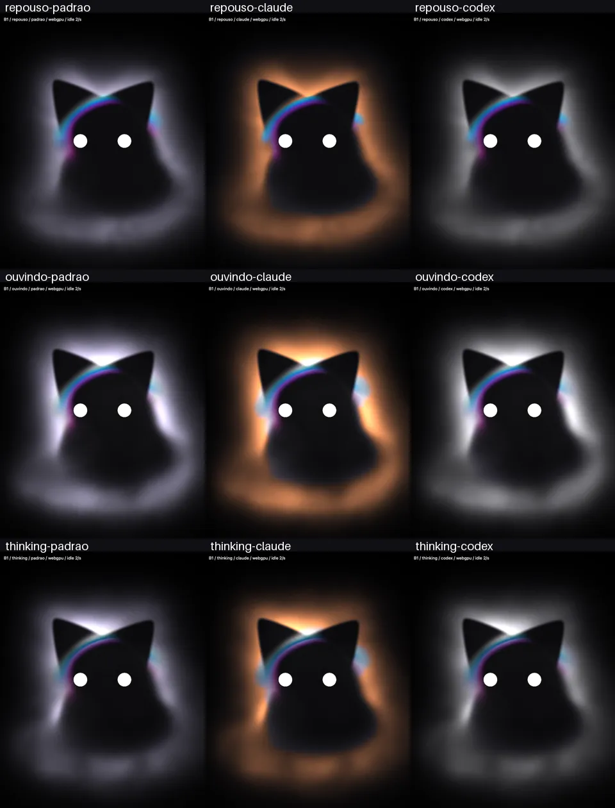

# Névoa do Kiwi-cat — T8487

Spec Kiwi #7549 · issue #376 · PR #377.

O harry escolheu **B1 algodão** (#8754). Ela é a única textura do runtime;
A e B2 ficam apenas no histórico. O lead confirmou a correção das argolas
nas pontas do aro e da linha no corpo (#8751), e aceitou a cadência quieta
de 2/s após comparar os vídeos (#8900).

## Vídeos finais

Resolução inteira, 640 × 800 / DPR 1. Relógio, voz e semente controlados;
simulação a 60 Hz e exportação a 30 fps. Quadros repetidos permanecem
repetidos, sem interpolação, sem áudio. Não se mede FPS pelo MP4.

| Estado | Kiwi | Claude Code | Codex |
| --- | --- | --- | --- |
| Repouso | [vídeo](final-b1/videos/repouso-padrao.mp4) | [vídeo](final-b1/videos/repouso-claude.mp4) | [vídeo](final-b1/videos/repouso-codex.mp4) |
| Ouvindo, voz sintética | [vídeo](final-b1/videos/ouvindo-padrao.mp4) | [vídeo](final-b1/videos/ouvindo-claude.mp4) | [vídeo](final-b1/videos/ouvindo-codex.mp4) |
| Thinking | [vídeo](final-b1/videos/thinking-padrao.mp4) | [vídeo](final-b1/videos/thinking-claude.mp4) | [vídeo](final-b1/videos/thinking-codex.mp4) |

[60 segundos de repouso](final-b1/videos/repouso-60s.mp4) ·
[relatório da captura](final-b1/videos/report.json).

## Desempenho da demonstração

**Média das três rodadas: 2,897% de um núcleo.** Resultados individuais:
2,598 / 3,013 / 3,080%; p95: 4,025 / 4,977 / 4,031%. Duas rodadas isoladas
excederam 3%; o critério combinado é a média das três (#8651).

Repouso e sono ficaram em 2 fps; os seis estados ativos, entre 59,98 e
60,10 fps. Os intervalos reais dos desenhos fornecem esses números. Cada
execução aquece 10 s e mede 60 s por prazo monotônico, somando os cinco
processos próprios, sem gravar. As janelas de CPU dos outros estados são
diagnósticas, de 3 s após 1 s de estabilização.

[Resultados completos, CPU por processo e brutos](final-b1/medidas-finais/README.md).
**Os números valem para a página de demonstração, não para o WKWebView do app.**

As duas matrizes a 3/s reprovaram as três escalas; todos os resultados estão
preservados: [inicial](final-b1/medidas-iniciais/README.md) e
[após o ajuste de agendamento](final-b1/medidas-demanda/README.md).
O plano B foi a [comparação 3/s × 2/s](final-b1/cadencia/README.md), sem mudar
a função da B1 ou os estados ativos. Não se subtraiu a base parada do aceite.

## Verificações funcionais

- [Referência final v2](final-b1/referencia.json): máximo 2/255 fora dos olhos
  +5 px, incluindo a névoa, em 2048 × 2560 e t=0; limite pedido de 4/255.
- [Apresentação nativa e invariância dos pixels](final-b1/cadencia/funcional-2fps/verification.json):
  15 quadros na mesma cadência controlada idênticos ao `5a78555`. Vídeo nativo
  comprova movimento quieto e mudança de cor com Reduzir movimento.
- [WebGPU, WebGL2 e fallback sem GPU](final-b1/cadencia/funcional-2fps/backends.json):
  ocultação para os desenhos; redução de movimento, baixa capacidade e
  descarte passam. Nenhum heartbeat de RAF fica rodando quando parado.
- [Varredura ativa B1](final-b1/exposicao-ativa/): 182 quadros, dois estados
  × 91 exposições de 0,50 a 1,40, incluindo controles de voz máxima.
  Monotonicidade e emissão do aro com ganho até 1 dentro de 2/255.
- [Uso prolongado](final-b1/longa-duracao/): alongamento radial limitado para
  evitar filamentos após uma hora virtual; fase e advecção continuam.
- [Prova inicial de captura e aceleração](prova-captura/README.md): WebKit
  headless com WebGPU Apple, vídeo não preto. Nenhum outro navegador.

A composição separa luz neutra e emissão cromática calibrada do aro,
limitada a ganho 1. A curva escura ativa não revela a linha do corpo.
Sem partículas, blur ao vivo ou imagens deslocadas. O
[agendamento sob demanda](final-b1/agendamento/README.md) preserva os pixels.

Não foram abertos app, helper, microfone ou clipboard reais.
[Contrato, limitações e comandos](../../../../app/ui/kiwicat/README.md).

## Histórico

O harry escolheu o movimento B no #8693 e a textura B1 no #8754. Os vídeos
e as imagens dos estudos A/B/B2 foram retirados da entrega para reduzir o
peso no repositório; os relatórios JSON permanecem preservados.
As medidas antigas em `medidas/` usavam intervalos nominais e não são
aceite de desempenho da textura final.
