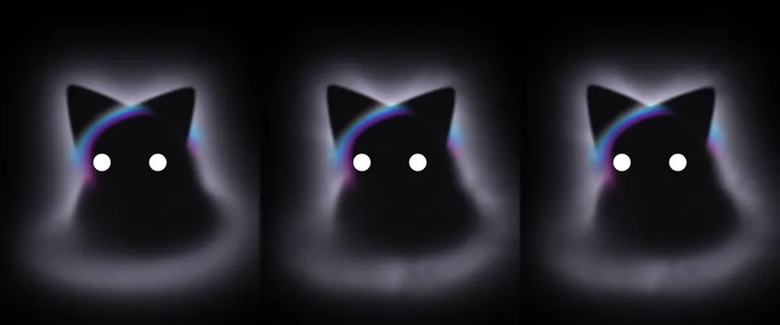

# Desenho sob demanda, sem alterar a B1

As três escalas da primeira matriz ficaram acima do teto de 3% em repouso
([relatórios completos](../medidas-iniciais/README.md)). A resolução não
explicou a maior parte do custo. A otimização atua no agendamento:

- O RAF interno do three 0.187 é substituído por um contexto local que não
  agenda outro callback. A atualização síncrona da biblioteca é mantida.
- O temporizador do repouso desenha diretamente no prazo, a 3/s, evitando
  despertar também o display link. Ativos e transições continuam em RAF real.
- Não mudam os shaders, assets, campos de densidade, relógio ou cadência.

[Verificação](verification.json): 15 PNGs controlados de repouso, ouvindo e
thinking são idênticos ao `5a78555`, pixel a pixel. O
[vídeo nativo](native-idle.webm), sem screenshots nem chamadas a `capture()`,
mostra a apresentação real do repouso; a diferença média entre os instantes
amostrados é maior que 1,7/255. A página escondida para de desenhar. A mudança
de cor com Reduzir movimento também aparece no vídeo nativo, com dois desenhos.



[WebGPU, WebGL2 e ausência de GPU](backends.json) passam os mesmos controles
de ocultação, redução de movimento, capacidade baixa e descarte. Typecheck
passou; 15 testes de dinâmica e créditos passaram, com 113 asserções.

As sondagens de uma execução deram 3,429% sem RAF interno e 3,013% com o
temporizador direto. São diagnóstico, **não aceite de desempenho**. O critério
usa a média das três repetições da matriz completa, sem descartar execuções.
Os JSONs das sondagens trazem o commit-base e os hashes exatos das fontes
com as alterações locais que estavam sendo testadas.

Reprodução funcional, com o mesmo WebKit headless:

```sh
# Rode no commit anterior e preserve a saída:
bun app/scripts/kiwicat-renderer-check.ts /tmp/fog-before
# Depois, no candidato:
bun app/scripts/kiwicat-renderer-check.ts /tmp/fog-after
# Python com Pillow e NumPy; também requer ffmpeg:
python app/scripts/kiwicat-verify-scheduling.py /tmp/fog-before /tmp/fog-after
```

São provas da demonstração, não do WKWebView dentro do app. Nenhum app,
helper, microfone ou clipboard real foi usado.
