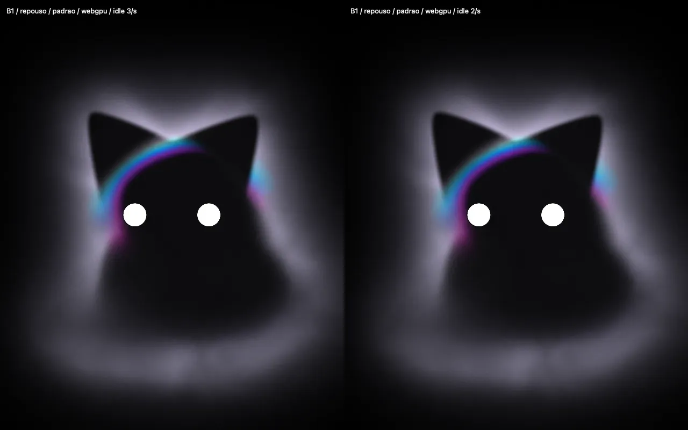

# Repouso: 3/s × 2/s

O plano B do lead (#8862/#8893) reduz apenas a cadência quieta, depois de a
matriz de três repetições por escala reprovar a3/s. Não muda a função da
B1, a semente, a voz, as cores ou a cadência dos estados ativos.

[Vídeo lado a lado](repouso-3-vs-2.mp4): **3/s à esquerda, 2/s à direita**.
Relógio/semente controlados,640×800 por painel,8s, exportação30fps e simulação
60Hz; sem interpolação. Os relatórios registram24/16 quadros distintos,
respectivamente. Não são medições de desempenho.



O padrão do módulo e da demonstração passa a2/s em repouso/sono. Transições
mantêm o reforço temporário a30fps e os estados ativos continuam com RAF real
(alvo60fps). Não extrapolar essa cadência da névoa para os futuros gestos do gato.

A [prova funcional](funcional-2fps/verification.json) compara os15quadros
controlados na mesma cadência3/s com o commit5a78555: pixels idênticos. O
repouso nativo usa o novo padrão2/s, sem chamadas a `capture()` nem screenshots,
e continua apresentando mudanças; escondido, para de desenhar. Os
[backends e fallbacks](funcional-2fps/backends.json) também passaram.

```sh
KIWI_FOG_IDLE_FPS=3 bun app/scripts/kiwicat-capture.ts /tmp/cadence3 repouso-padrao
KIWI_FOG_IDLE_FPS=2 bun app/scripts/kiwicat-capture.ts /tmp/cadence2 repouso-padrao
```

O arquivo lado a lado é um `hstack` dos dois MP4, sem retiming. A aprovação
visual final cabe ao lead/harry. O aceite de CPU usa três execuções separadas,
na escala inteira, a2/s, sem gravação simultânea.
