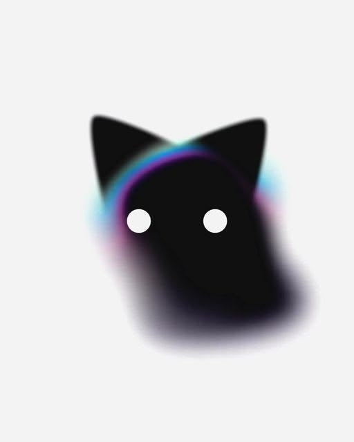

# Kiwi — Roteiro da animação de abertura

Nov 4, 2026 · @Davi Vicente Ayres Gonçaves

## Conceito e regras visuais

Esta é a abertura do Kiwi Notes. Na janela `intro` do app, o prisma da marca Kiwi Init toca primeiro e termina implodindo num círculo de vidro; nesse mesmo frame começa o gato. A névoa gira em volta do círculo, e o gato acorda parte por parte até o corpo se formar da própria névoa. Quando ele termina de assentar, a janela fecha e o hub abre. O estado de repouso (respirar, flutuar, olhar, piscar, mexer orelhas e rabo) vive fora da intro: no hub, no Sobre e no overlay do ditado. Sem som.

O movimento se inspira no estilo do gato de Cheshire (surgir em partes, flutuar sem peso, cabeça independente do corpo), com beats próprios do Kiwi. O visual segue a [imagem de referência](referencia.jpg): cabeça preta sólida, olhos brancos chapados, um aro prismático por dentro do topo da cabeça e o corpo se dissolvendo em névoa, sobre fundo preto.

Regras que valem para todos os frames:

1. **O gato é a nuvem.** Não existe um corpo sólido com blur atrás. Abaixo da cabeça, o gato inteiro é névoa.
2. **Sem contorno.** Nenhuma linha em nenhuma parte. Os limites vêm da luz e da densidade da névoa.
3. **A névoa é redonda e contínua.** Ela forma um halo uniforme, sem pontas, lobos ou braços. Girando, parece uma nuvem macia, nunca uma shuriken.
4. **O círculo não tem borda dura.** O limite dele se desfaz na névoa, então ele parece flutuar em vez de estar recortado.
5. **A cabeça é o círculo.** As orelhas brotam de dentro dele, levantando como as de um gato que estava com a orelha baixa, e o círculo termina no formato da cabeça da referência.
6. **Olhos 100% nítidos.** Sem blur, sem glow e sem halo nos olhos.
7. **Tudo é orgânico.** Nenhum movimento linear. Toda ação tem aceleração, overshoot leve e assentamento.

### A cabeça da referência

- **Orelhas:** altas, pontudas e abertas para fora, com base larga. Sem entalhe, como na referência.
- **Topo:** levemente côncavo entre as orelhas.
- **Rosto:** formato de escudo que afina para um queixo arredondado. O queixo não tem borda; ele se dissolve na névoa do corpo.
- **Olhos:** dois pontos brancos chapados, grandes e bem separados, na altura mais larga do rosto.
- **Aro prismático:** uma faixa fina de luz por dentro do topo da cabeça, logo abaixo da base das orelhas, indo do ciano à esquerda ao púrpura à direita.

### A emenda com o prisma

O prisma é uma animação separada, com roteiro próprio, mas o último frame dele é o primeiro frame do gato. É isso que deixa a passagem sem corte.

- **O frame da emenda:** um círculo de vidro em (512, 430), raio 225 px, com a mesma tinta e o mesmo brilho especular do B1. O prisma termina exatamente nele.
- **O movimento continua:** o prisma chega ao círculo implodindo, e o gato absorve esse impulso num assentamento de escala 1,03 → 1,00 nos primeiros 18 frames.
- **Sem fade entre os dois:** o `intro.js` passa do prisma para o Rive no frame da emenda (hoje, aos 3,7 s), com o círculo já visível nos dois.
- **A névoa chega logo:** ela começa a nascer 6 frames depois da emenda, para o olho ligar o giro ao círculo.

O prisma também precisa de uma correção no roteiro dele: hoje as lâminas abrem retas para cima, e no logo elas sobem em escada na diagonal para a direita.

- **Direção:** cada lâmina fica deslocada cerca de 14 unidades para a direita e 17 para cima em relação à de baixo (no viewBox de 96 do logo), uns 51° da horizontal.
- **Leque:** a borda longa inclina 17°, 21° e 24° da lâmina de baixo para a de cima, e a borda curta encurta de 27,7 para 24,9 e 22,2, como páginas abrindo.
- **Formato:** lâminas compridas e finas, com cantos vivos e espessura saindo para baixo e para a esquerda.

## Especificações técnicas

O gato é a imagem de referência aprovada (`referencia-final.png`) em camadas, animada com CSS na intro do app (T3720; a
decisão do harry em #3718, no lugar do Rive). A animação da intro tem 8 s a 60 fps (f0 a f480). Cada camada é um ``
embutido na janela `intro`, e o CSS só move, gira, escala e esmaece: nada é borrado ao vivo.

| Item | Valor |
| --- | --- |
| Camadas | `docs/brand/kiwi-cat/camadas/` (WebP com alfa, no espaço da foto, 512 × 640), com o contrato em `camadas.json` |
| Palco | 1024 × 1024 px: o palco do ícone, um quadrado preto com cantos de raio 224 |
| Área segura | Nada importante a menos de 64 px da borda; os cantos arredondados cortam o que passar |
| A intro | As animações CSS do `docs/brand/intro/intro.template.html`, de f0 a f480; em f480 o script chama o `intro.done` |
| O repouso (`idle`) | Fora desta task: um componente para o hub, o Sobre e o overlay, em loop de 12 s |
| Fundo | Preto #000000 dentro do palco; fora dele, a janela é transparente |
| Unidade R | 225 px, o raio do círculo inicial |
| Centro da cabeça | (512, 430) |
| Encaixe da foto | ×1,6, com o meio dos olhos (256, 320) em (512, 414) |
| Flutuação | Seno vertical de ±12 px, período de 4 s, de f18 em diante |

No "Reduzir movimento", o app mostra a pose final parada, com um fade.

Camadas, de trás para frente. Os nomes são os das camadas em `camadas/` e os ids no HTML da intro.

| # | Camada | Como é feita | Pivô |
| --- | --- | --- | --- |
| 1 | Fundo | Retângulo preto do palco | — |
| 2 | Névoa ambiente | 3 sprites assados de nuvem escura, quase parados | — |
| 3 | Anel de névoa | 1 sprite assado do anel colorido, mais 4 manchas soltas | Centro da cabeça |
| 4 | Corpo de névoa | 6 sprites assados de densidade, que derivam devagar | Base do corpo |
| 5 | Cauda | Forma vetorial com degradê e trim path | Base da cauda |
| 6 | Cabeça | Círculo de vidro (vetor e sprite do brilho) que vira a cabeça vetorial, com alfa caindo até o queixo | Centro da cabeça |
| 7 | Orelhas (2) | Vetores mascarados pela cabeça | Base de cada orelha |
| 8 | Olhos (2) | Vetor branco puro, sem efeito | Centro de cada olho |
| 9 | Aro prismático | Sprite assado da faixa de luz | Centro da cabeça |

A flutuação move juntas as camadas 3 a 9. A névoa ambiente fica parada para dar referência de profundidade.

## Paleta e névoa de partículas

A paleta vem da imagem de referência: um degradê frio de ciano a púrpura no aro e nas laterais, um toque de ameixa embaixo à esquerda e uma lavanda difusa na base. A coluna da referência foi amostrada do arquivo sobre fundo cinza, por isso é mais apagada; a coluna do fundo preto mantém o mesmo tom com mais saturação e brilho.

| Cor | Na referência | No fundo preto | Onde aparece |
| --- | --- | --- | --- |
| Ciano | #238CBC (aro), #B2E1E9 (halo) | #3FD8FF | Começo do aro, à esquerda, e halo nas laterais da cabeça |
| Azul | #208DD2 | #2E9BFF | Aro, logo depois do ciano |
| Anil | #446ED2 | #4F72FF | Meio do aro |
| Violeta | #6A46B0 | #8B5CFF | Aro e névoa do lado direito |
| Púrpura | #612A7B | #A245E0 | Fim do aro e borda direita do corpo |
| Ameixa | #844780 | #D35FC9 | Névoa baixa à esquerda |
| Lavanda | #9B98A3 | #8C84B0 | Névoa da base do corpo, a mais difusa |
| Corpo | #101010 | #0A0A0F | Cabeça e miolo da névoa do corpo |
| Olhos | Branco | #FFFFFF | Olhos, sem nenhum efeito |

Durante o giro da intro, a roda de cor percorre ciano → azul → anil → violeta → púrpura → ameixa e volta ao ciano, sempre por interpolação suave entre vizinhas, sem faixas visíveis.

### Como a névoa é feita

Nada é borrado ao vivo, como manda a regra #2085 do repo. A névoa vem de sprites assados: imagens PNG com alfa, já borradas, geradas por um script a partir de um campo de partículas e embutidas no `.riv`. O Rive só move, gira, escala e esmaece essas imagens, que é o mesmo truque que a intro atual usa para a aura.

| Sprite | Quantidade | Tamanho assado | Uso |
| --- | --- | --- | --- |
| Anel de névoa | 1 | 512 × 512 | O halo contínuo com a roda de cor, que gira na intro |
| Manchas de cor | 4 | 256 × 256 | Volume extra no anel, cada uma com órbita própria |
| Corpo de névoa | 6 | 256 × 256 | A massa do corpo, do tom do corpo à lavanda |
| Névoa ambiente | 3 | 256 × 256 | Fundo escuro, quase parado |
| Aro prismático | 1 | 512 × 128 | A faixa de luz por dentro do topo da cabeça |
| Brilho do vidro | 1 | 256 × 256 | O especular do círculo no B1 |

- **Por que não tem ponta:** o anel é uma imagem só e contínua. Girar um borrado pronto não muda a borda, então não existe o efeito shuriken.
- **Resolução:** os sprites são assados à metade do tamanho de uso; como são borrados, a ampliação não aparece. O alvo é ficar abaixo de 300 KB somando todos.
- **Movimento de partícula:** cada sprite do corpo e cada mancha deriva numa órbita lenta com período próprio, sempre um divisor de 12 s, para o `idle` fechar o loop sem emenda.
- **Uniformidade:** em qualquer ângulo a densidade do anel varia no máximo 10%.
- **Borda do círculo:** um sprite de névoa cobre a borda do círculo por dentro, invadindo 0,08 R, e é ele que faz o limite sumir.
- **Desempenho:** a meta é a mesma da intro atual no README do repo: mediana de 17 ms por frame no WebKit headless.

## Linha do tempo

&#91;embedded content: linha do tempo da intro do gato · 12 camadas, f0 a f480\]

As ações se sobrepõem de propósito: cada uma começa antes da anterior assentar, e é isso que deixa o movimento orgânico. O detalhe de cada barra está na seção de beats.

## Beats, frame a frame

As curvas usam cubic-bezier. **Saída suave** = (0.2, 0.8, 0.2, 1). **Entrada e saída** = (0.45, 0, 0.25, 1). **Mola** = (0.34, 1.56, 0.64, 1).

### B1 · O círculo de vidro (f0–f60)

O f0 é o frame da emenda: o círculo já está inteiro, vindo da implosão do prisma. Entre f0 e f18 ele assenta de escala 1,03 para 1,00 em saída suave, e a flutuação começa em f18.

O vidro é escuro: tinta #05060C a 85%, com um brilho especular de 25% em arco no canto superior esquerdo (o sprite do brilho). **Não existe anel de borda.** O limite do círculo é dado pela névoa que invade a borda.

### B2 · A névoa nasce e gira (f6–f180)

- **f6–f48:** o anel de névoa aparece (opacidade 0 → 100%) e acelera de parado até 1 volta a cada 2,5 s. É esse giro rápido no início que dá a impressão de que o círculo está girando.
- **f48–f180:** o giro desacelera em saída suave até 1 volta a cada 8 s.
- **f36–f96:** o sprite da borda cresce e a névoa invade o círculo. A partir daqui ele não tem mais limite definido.

### B3 · As orelhas levantam (f96–f156)

As orelhas brotam de dentro da cabeça, mascaradas pelo contorno dela, e aparecem conforme cruzam esse limite.

- **Orelha esquerda (f96–f126):** começa abaixada, girada 75° para fora em torno da base e com escala 0,6. Levanta em mola, passa 8° do ponto, volta 3° e assenta em 0°.
- **Orelha direita (f112–f142):** o mesmo movimento, espelhado e 16 frames depois.
- **Tremidinha (f146–f156):** quando a direita assenta, a esquerda treme 4° e volta.

Entre f130 e f190 o círculo se transforma no formato da cabeça da referência: o topo achata entre as orelhas, os lados ficam mais retos e a parte de baixo afina para o queixo, que continua se desfazendo na névoa.

### B4 · Os olhos acordam (f160–f268)

Os olhos são vetor branco #FFFFFF puro, sem blur, glow ou halo. Começam 2% abaixo da posição final e com escala 0,8, como olhos sonolentos e baixinhos.

| Frames | Ação | Abertura (scaleY) |
| --- | --- | --- |
| f160–f163 | Surgem como fresta | 0 → 0,06 |
| f163–f181 | Abrem devagar, sonolentos | 0,06 → 0,22 |
| f181–f196 | Seguram meio abertos | 0,22 |
| f196–f204 | Fecham de novo | 0,22 → 0,04 |
| f204–f212 | Seguram fechados | 0,04 |
| f212–f228 | Abrem um pouco mais | 0,04 → 0,45 |
| f234–f244 | Piscada curta | 0,45 → 0,05 → 0,45 |
| f248–f268 | Abrem de vez, sobem para a posição final e crescem até escala 1 | 0,45 → 1,04 → 1,00 |

No frame em que os olhos abrem de vez (f262), a névoa ganha +10% de brilho por 20 frames. Os olhos continuam sem nenhum efeito.

### B5 · A cauda gira (f270–f330)

Ainda não existe corpo. A cauda surge na névoa embaixo à direita, onde o corpo vai estar.

- **f270–f310:** a cauda cresce da base até a ponta (trim path 0 → 100%), desenrolando de uma espiral fechada para a curva final enquanto gira de 220° para 0° em torno da base.
- **f310–f330:** ela assenta com uma onda em S, a ponta 6 frames atrasada em relação à base.
- **Base da cauda:** os primeiros 15% do traço têm alfa em degradê, saindo da névoa sem começo duro.

### B6 · O corpo se forma da névoa (f300–f390)

Os sprites do corpo descem do anel e convergem para o volume do corpo. A forma é dada pela densidade da névoa, não por uma silhueta recortada.

- **Densidade:** alta logo abaixo da cabeça e ao longo da borda; o miolo fica mais escuro.
- **Base:** a densidade cai até zero nos 25% de baixo, então o corpo se dissolve embaixo como na imagem de referência.
- **Vida interna:** os sprites seguem derivando devagar, para o corpo parecer respirar.
- **Aura:** a roda de cor se reorganiza nas posições da referência: ciano nas laterais da cabeça, violeta e púrpura à direita, ameixa embaixo à esquerda e lavanda na base.

Entre f330 e f370 a cabeça termina de virar sólida: a tinta do vidro vai a 100% e o brilho especular some.

### B7 · O aro acende e tudo assenta (f350–f480)

Entre f350 e f400 o aro prismático acende por dentro do topo da cabeça, correndo do ciano à esquerda até o púrpura à direita. Ele é luz, não linha: as pontas somem antes de chegar às orelhas. Entre f400 e f450 a névoa encontra as posições finais, e de f450 a f480 o gato fica na pose final.

No f480 a state machine `intro` dispara o `done`. O `intro.js` esmaece o palco em 0,35 s, a janela fecha e o hub abre.

### O estado de repouso (state machine `idle`, fora da intro)

O gato parado, mas vivo, no hub, no Sobre e no overlay. São 12 s em loop (f0 a f720): os ciclos contínuos dividem os 12 s, e os eventos ficam em intervalos irregulares para o olho não perceber a repetição.

Ciclos contínuos:

- **Flutuação:** seno vertical de 4 s.
- **Respiração do corpo:** os sprites do corpo crescem de escala 1,00 para 1,02 a cada 3 s, e a cabeça sobe 1 px junto.
- **Rabo:** balanço de ±6° em 4 s, com a ponta 6 frames atrasada.
- **Névoa:** o anel oscila ±10° em 12 s, e as manchas seguem nas órbitas delas.
- **Aro:** o brilho pulsa ±8% em 6 s.

Eventos:

| Frames | Tempo | Ação |
| --- | --- | --- |
| f60–f72 | 1,0 s | Piscada normal (12 frames) |
| f120–f132 | 2,0 s | Tremida da orelha direita, 6° |
| f180–f280 | 3,0 a 4,7 s | Olha para a esquerda: os olhos deslizam 0,06 R e a cabeça gira 3° junto em 20 frames, seguram e voltam |
| f300–f336 | 5,0 s | Piscada dupla, duas de 12 frames com 12 de intervalo |
| f360–f390 | 6,0 s | Chicotada do rabo, +12° por cima do balanço |
| f420–f520 | 7,0 a 8,7 s | Olha para a direita, espelho do olhar para a esquerda |
| f480–f510 | 8,0 s | A orelha esquerda gira 8° para fora e volta, como quem escuta o lado |
| f570–f630 | 9,5 s | Respiração mais funda: escala 1,04 no corpo, aro +15% |
| f648–f672 | 10,8 s | Piscada lenta e sonolenta (24 frames) |

Em f720 tudo volta à pose de f0, e o loop recomeça. A pose de f0 do `idle` é a mesma do f480 da `intro`.

## O que evitar

| Erro | Por que acontece | Como corrigir |
| --- | --- | --- |
| Névoa com pontas (shuriken) | Manchas separadas parcialmente escondidas atrás do círculo, ou formas alongadas girando | Usar o toro contínuo de partículas, com densidade uniforme no ângulo |
| Blur que fica nítido durante a animação | Blur aplicado dentro de uma camada que escala | Assar a névoa em sprites já borrados; o Rive só gira, escala e esmaece |
| Círculo recortado | Máscara sem feather ou com traço na borda | Feather de 6% a 14% e névoa invadindo a borda |
| Névoa como fundo atrás do gato | Corpo sólido com um glow embaixo | O corpo inteiro é partícula; não existe forma sólida de corpo |
| Olhos borrados | Bloom global pegando os olhos | Olhos numa camada acima do bloom, fora de qualquer efeito |
| Orelhas surgindo de trás | Orelha animada com translate de baixo para cima | Rotação a partir da base, mascarada pela cabeça |
| Partículas parecendo poeira ou brilhos | Partículas grandes ou com borda dura | Sprites assados de um campo de partículas com bloom, nunca pontos soltos |
| Movimento mecânico | Interpolação linear ou ações que começam e terminam juntas | Curvas da seção de beats e sobreposição de 10 a 20 frames entre ações |
| Parecer cópia da Disney | Listras, sorriso largo ou planos iguais aos do filme | Só o estilo de movimento; os beats e o visual são do Kiwi |

## Decisões

| Tema | Decisão |
| --- | --- |
| Ferramenta | Rive, como o repo já decidiu (spec #3133), com a névoa em sprites assados |
| Onde entra | Na janela `intro` do Kiwi Notes, no lugar do gato em SVG |
| Prisma | Animação separada da marca Kiwi Init, com o ângulo corrigido; o gato começa no frame em que ele termina |
| Repouso | Fora da intro: state machine `idle` para o hub, o Sobre e o overlay |
| Paleta | Cores da imagem de referência (seção de paleta) |
| Cabeça | Formato da imagem de referência, sem entalhe na orelha |
| Contorno | Nenhum: o gato é a nuvem |
| Corpo (T3720) | Na imagem aprovada o corpo é escuro e sólido, com a névoa em volta e se desfazendo na base: a regra 1 e o B6 valem para essa névoa, não para um corpo só de partículas |
| Cauda (T3720) | A imagem aprovada não tem cauda: o B5 fica de fora da intro |
| Som | Sem som por enquanto |
| Formato | Palco quadrado do ícone, fundo preto |
