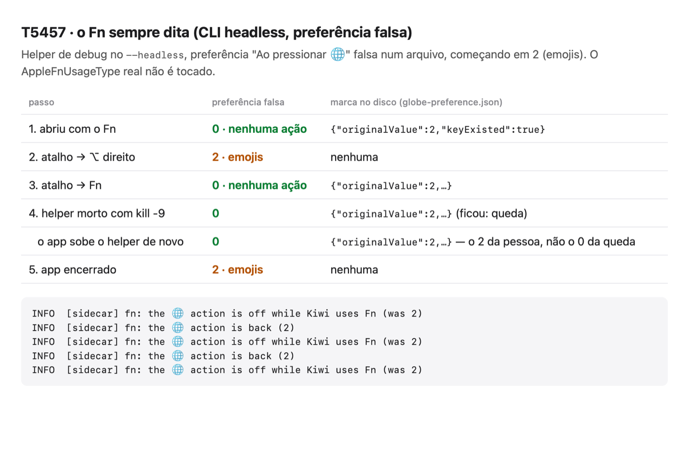

# T5457 · L6: o Fn sempre dita, sem abrir os emojis

Issue #157, onda 2 do levelup (spec Kiwi #5292). Decisão do harry (#4756); o cuidado de teste é o #4871.

**Nada aqui toca o `AppleFnUsageType` real.** No headless e com `KIWI_DEBUG=1`, o helper usa uma preferência falsa num arquivo (`fn-usage-fake.json`, ao lado do socket). O valor inicial vem de `KIWI_FAKE_FN_USAGE`: 0 nenhuma ação, 1 fonte de entrada, 2 emojis, 3 ditar. A de verdade (`TISUpdateFnUsageType`, o que os Ajustes chamam) só roda no app do harry.

## Ponta a ponta (CLI headless, helper de debug, sob o `kiwi lock bench`)


Com a preferência falsa em 2 (emojis):

| passo | preferência | marca no disco |
|---|---|---|
| 1. abriu com o Fn | `0` (nenhuma ação) | `{"originalValue":2,"keyExisted":true}` |
| 2. atalho → ⌥ direito (`settings.set`) | `2` | nenhuma |
| 3. atalho → Fn | `0` | `{"originalValue":2,…}` |
| 4. helper morto com `kill -9` | `0` | `{"originalValue":2,…}` (ficou: é a queda) |
| … o app sobe o helper de novo | `0` | `{"originalValue":2,…}`: desfez a troca que sobrou e trocou de novo, com o 2 da pessoa, não o 0 da queda |
| 5. app encerrado (`cli stop`: o socket fecha e chega o SIGTERM) | `2` | nenhuma |

O log em arquivo (as linhas `fn:` do helper agora entram, sem texto nenhum):
```
INFO  [sidecar] fn: the 🌐 action is off while Kiwi uses Fn (was 2)
INFO  [sidecar] fn: the 🌐 action is back (2)
INFO  [sidecar] fn: the 🌐 action is off while Kiwi uses Fn (was 2)
INFO  [sidecar] fn: the 🌐 action is back (2)
INFO  [sidecar] fn: the 🌐 action is off while Kiwi uses Fn (was 2)
```
A volta do passo 5 não aparece no log porque o socket já fechou; a preferência e a marca mostram que ela aconteceu.

## `swift test` (`GlobeKeyTests`, peça falsa)
- O Fn como atalho guarda a preferência no disco antes de trocar, troca para "Nenhuma ação" e devolve ao sair.
- Sem onde gravar a marca, nada troca.
- Trocar o atalho devolve, e voltar para o Fn troca de novo (duas vezes no Fn é uma troca só).
- Depois de uma queda, a abertura desfaz primeiro, com o valor da pessoa.
- Se a pessoa mudou a ação nos Ajustes (com o Kiwi aberto ou depois de uma queda), a dela ganha.
- Já em "Nenhuma ação", ou sem como ler: nada a fazer.
- Uma chave que era o padrão do macOS volta a ser o padrão.

## Falta
O teste de verdade é do harry, pelo roteiro do lead: com o Kiwi aberto, o Fn dita e não abre os emojis; ao sair, o 🌐 volta a fazer o que ele tinha escolhido.
