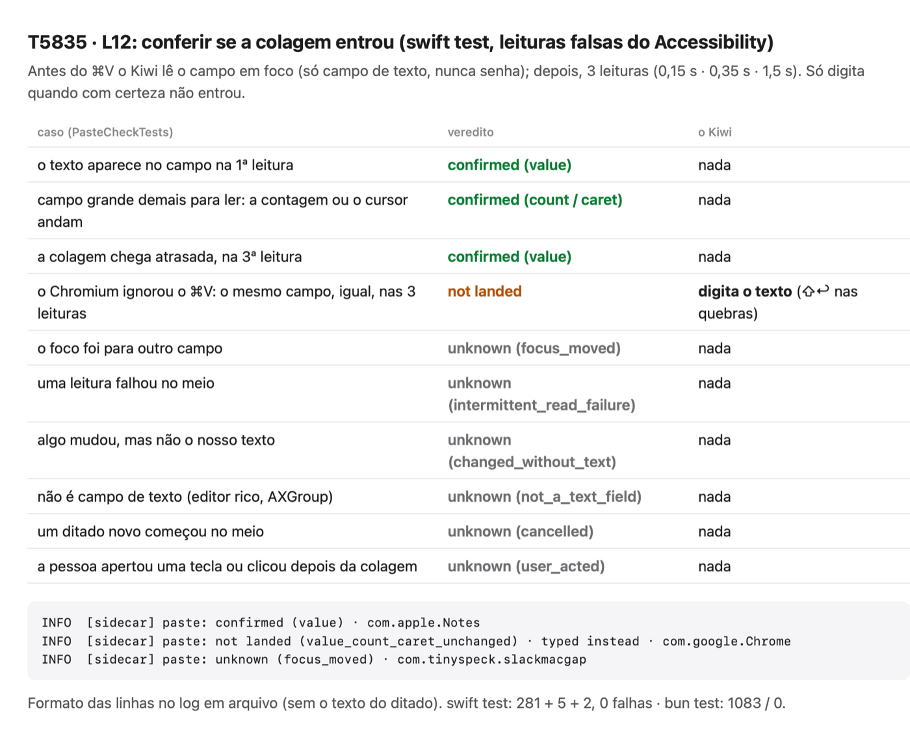

# T5835 · L12: conferir se a colagem entrou (e digitar no Chromium)

Issue #163, onda 4 do levelup (spec Kiwi #5825). Sem app de verdade, sem o clipboard real e sem teclas reais: o veredito é testado com leituras falsas do Accessibility. A colagem num Chromium real é do roteiro do harry.

- **Antes do ⌘V:** o helper lê o campo em foco: papel, texto (até 60 mil caracteres), contagem e cursor. Só num campo de texto (AXTextField, AXTextArea, AXComboBox), nunca de senha, nem com o Secure Input ligado. O texto fica só na memória, para comparar, e nunca vai para o log.
- **Depois do ⌘V:** três leituras (0,15 s, 0,35 s e 1,5 s). É o `PasteCheck`, portado do `PasteVerifier` do FluidVoice (GPL-3.0).
- **Só com "not landed"** (o mesmo campo, igualzinho, nas três leituras) o texto é digitado, como teclas Unicode em pedaços de 20, com ⇧↩ nas quebras de linha: um ↩ sozinho enviaria a mensagem num chat.
- **Na dúvida, nada é digitado:** o foco mudou, uma leitura falhou, algo mudou sem ser o texto, não é campo de texto, um ditado novo começou, ou a pessoa apertou uma tecla ou clicou depois da colagem.
- **O log em arquivo** ganha a linha `paste: …`, com o veredito e o app, sem o texto.
