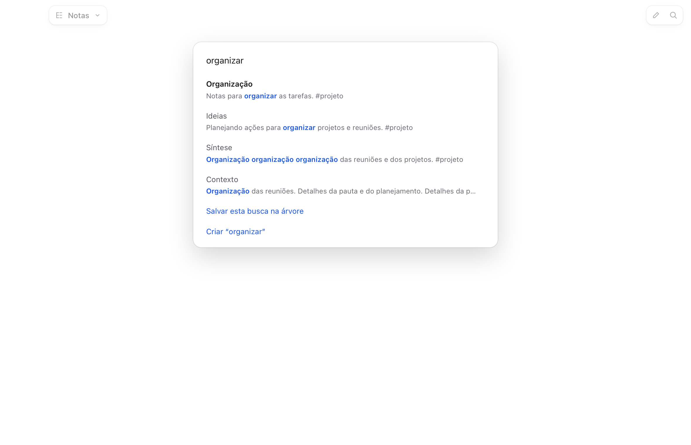
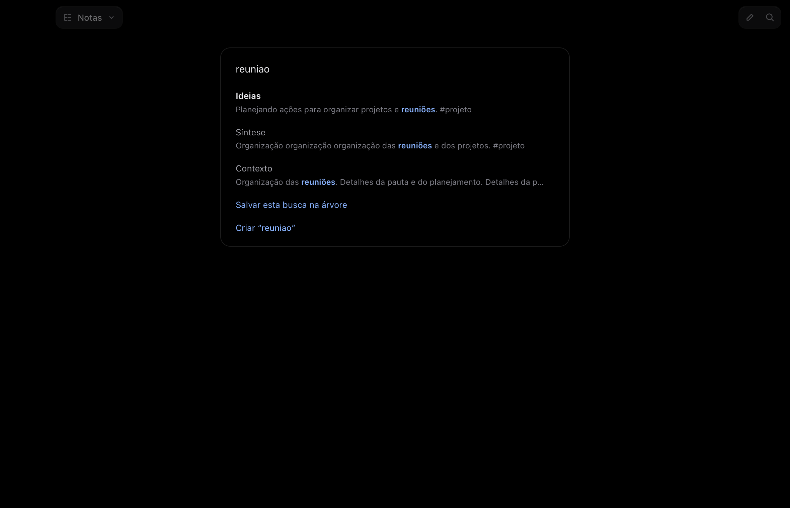

# T6011 · L16 · Busca BM25 e stemmer PT

Issue #167, spec Kiwi #5849 versão #5912, aprovado no #6005. Depois da E11, por ordem do harry #6016.

A busca lexical usa o índice invertido **FTS5 do SQLite do Bun**, em `:memory:` com `temp_store=MEMORY`. O ranking é o BM25 do FTS5, com título e aliases mais fortes que o corpo. A interface mantém a ordem do engine assim que chega a resposta; os títulos locais continuam aparecendo enquanto ela está a caminho. A árvore combina as notas do engine com a navegação por nome de pasta/arquivo.

O módulo português de `@orama/stemmers` **3.1.18 (Apache-2.0)** reduz as formas flexionadas; normalizamos também o plural regular nasal `ões → ão`. As variantes com e sem acento são indexadas. Isso é stemming lexical: não interpreta significado nem resolve todos os plurais irregulares. A busca semântica é a L17.

Palavras soltas usam prefixos e raízes; palavras precisam casar juntas. `"Frases"`, exclusões, `tag:` e `path:` mantêm as regras literais anteriores. O fuzzy roda quando não há resultado lexical dentro desses filtros, e não se mistura aos resultados lexicais encontrados. Os trechos destacam a forma que casou, mesmo quando difere da palavra digitada. Texto de anexos continua completando a lista no fluxo já existente.

O índice é montado na abertura, acompanha as versões do cache e só retokeniza o que mudou. Save, rename, pasta movida, lixeira, restauração e mudanças pelo watcher invalidam os postings. Não há arquivo de índice nem cópia do texto das notas fora do cofre; cada vault tem seu próprio banco em memória e o fecha no `close`.

## Verificação

**1115 testes passaram, 0 falharam**; typecheck passou. **52/52 passos em cada tema**, incluindo a alteração da nota com a busca aberta: o ranking se refaz sem digitar de novo. Sem erros de página, chamadas de rede, clipboard ou erros de capacidades.

```sh
cd app
bun test
bun run typecheck
kiwi lock bench --ttl 10m --note 'T6011: benchmark sintético'
bun scripts/notes-bench.ts 1000
kiwi unlock bench
bun run cli start --data /tmp/kiwi-l16 --no-helper
bun run cli ui notes --script scripts/ui-scripts/notas-bm25.json --out /tmp/kiwi-l16-prints --data /tmp/kiwi-l16
bun run cli stop --data /tmp/kiwi-l16
```

Repetir a UI com dados novos e `--theme dark`. Apenas dados sintéticos, WebKit headless e helper desligado. Nenhuma janela na tela, mic, áudio, clipboard ou diálogo do sistema.

Os testes verificam frequência, normalização por tamanho, formas PT, prefixos, filtros, frases, fallback, comandos tratados como texto, isolamento entre cofres, cache e ciclo de atualização dos postings. O roteiro compara a ordem do ⌘K com o `notes.search`, os destaques, os filtros, o fuzzy e a busca na árvore. Os `report.json` são as saídas integrais da CLI; `proof.json` é o resumo derivado.

No M1 Pro, com 1.000 notas sintéticas: abrir/indexar **527 ms**; medianas das buscas **1,8–16 ms**, pior **47,3 ms**. Não é uma comparação com a versão anterior. A saída integral está em `benchmark.txt`.

Referência técnica: [FTS5 e BM25](https://www.sqlite.org/fts5.html#the_bm25_function). Stemmer distribuído pelo [Orama](https://github.com/oramasearch/orama).



