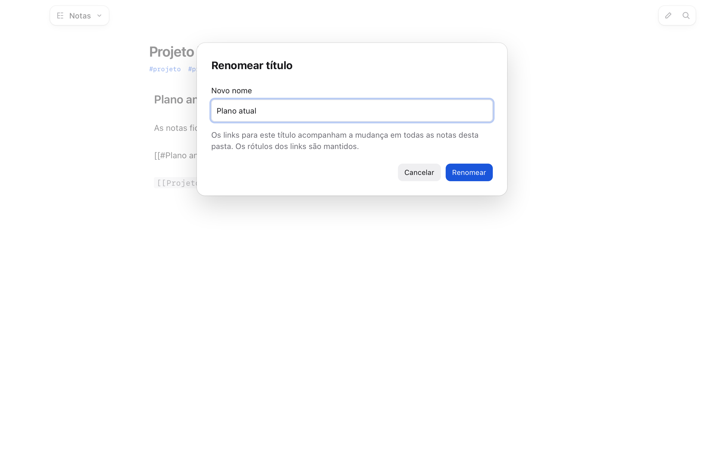
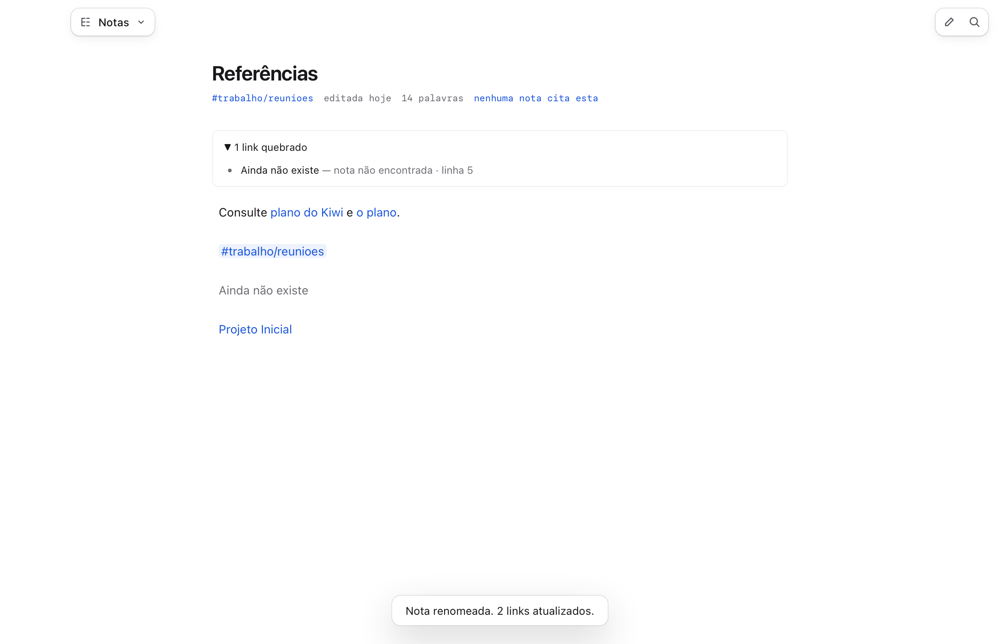
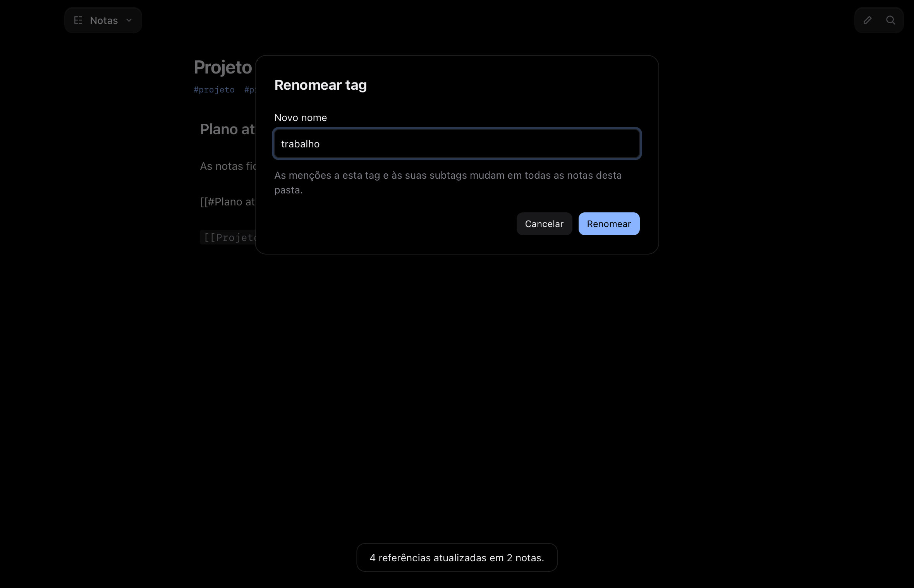

# T6014 · E11 · Renomear título e tag

Spec Kiwi #5849, versão #5912, aprovado no #6005. Issue #187.

## Resultado

- Renomear o arquivo pelo título continua atualizando os wikilinks, preserva aliases e agora cobre os links Markdown relativos (incluindo definições de referência). Exemplos em código, comentários e frontmatter ficam intactos.
- No botão direito de um título de seção, **Renomear título e seus links…** troca o título ATX/Setext e os fragmentos locais ou de outras notas. Preserva o rótulo explícito do link. Títulos de destino ambíguos são recusados; em títulos repetidos, links antigos continuam se referindo à primeira ocorrência.
- No botão direito da tag, na meta ou na árvore, **Renomear #tag…** atualiza as menções e subtags no corpo e nas propriedades YAML `tags`/`tag`. Mantém as outras propriedades, comentários, aspas e finais de linha. Âncoras/aliases YAML e formatos não suportados ficam intactos e a nota é apontada para conferência.
- O aviso expansível distingue nota ausente de título ausente, mostra a linha no arquivo e se atualiza quando a referência passa a existir. Limita a lista a 100 ocorrências. Âncoras de blocos `^id` ficam para a funcionalidade de blocos.
- As escritas usam a versão do disco e repetem até três vezes em caso de edição concorrente. O título de origem exige `baseVersion` e aborta antes dos links se perder a corrida. A operação entre várias notas não é uma transação global: notas que continuam em conflito, inacessíveis ou com YAML não suportado são informadas, sem sobrescrever edições alheias.

O parser YAML `yaml` 2.8.2 (ISC), fixado no lockfile, fornece as faixas dos escalares para trocar apenas as tags. O código do refactor é original do Kiwi; Foam é referência de comportamento, sem porte nem telemetria.

## Verificação

`bun test`: **1103 passaram, 0 falharam**. `bun run typecheck`: passou. WebKit: **48/48 passos em cada tema**, sem erros de página, saídas de rede ou clipboard. Os dois erros esperados nos relatórios são a colisão de tag exercitada pelo roteiro e a consulta do watcher ao caminho antigo durante o rename do arquivo.

```sh
cd app
bun test
bun run typecheck
bun run cli start --data /tmp/kiwi-e11 --no-helper
bun run cli ui notes --script scripts/ui-scripts/notas-refactor.json --theme light --out /tmp/kiwi-e11-prints --data /tmp/kiwi-e11
bun run cli stop --data /tmp/kiwi-e11
```

Repetir com dados novos e `--theme dark`. O roteiro tem 48 passos por tema: menu e formulário do título, nome de tag ocupado, tag com descendentes, nome do arquivo, referências na outra nota e resolução do link antes quebrado. O `proof.json` é um resumo derivado; cada `report.json` é a saída integral da CLI. Os conteúdos retornados por `notes.get` foram comparados com o resultado esperado byte a byte.

Os testes unitários cobrem código/comentários, links escapados, aliases, caminhos relativos, referência Markdown por definição, títulos repetidos, conflito antes e durante a escrita, preservação de edição concorrente, conflitos persistentes, YAML/CRLF e valores como `true` que precisam continuar strings.

Somente dados sintéticos e WebKit headless; helper desligado. Nenhuma janela no Mac, mic, clipboard, diálogo do sistema ou áudio real.




