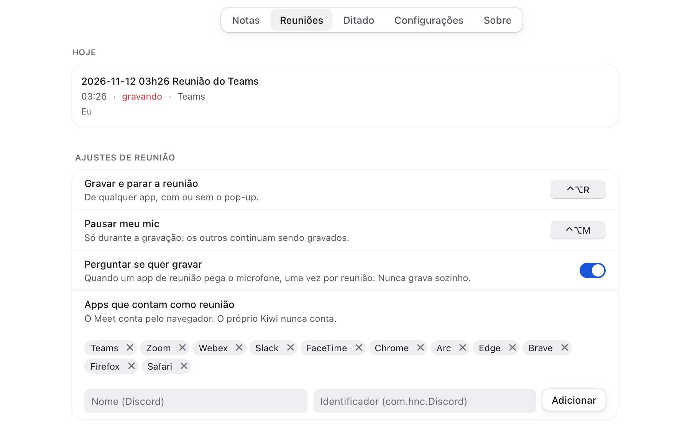

# Varredura: Robustez (área 8 do spec #7424, T7444)

A varredura foi feita em 2026-11-12, na `main` em `b121962`. Tudo rodou pelo engine headless, com os dados num tmp, e
pelos roteiros de `scripts/ui-scripts/` (`bun run cli ui`, WebKit headless). Nada apareceu na tela de ninguém.

- **O helper:** só o falso. É um processo em Bun que fala o mesmo IPC e cai, volta ou tira permissões quando o roteiro
  manda. Nenhum mic foi ligado e nenhum diálogo do macOS foi aberto (AGENTS.md).
- **O disco cheio:** uma imagem de 8 MB montada com `-nobrowse`, fora do Finder, com a pasta de dados e o cofre dentro.
- **A rede pendurada:** um proxy local que aceita a conexão e nunca responde.

## Resumo

| Cenário | Resultado |
|---|---|
| O helper cai no meio de um ditado | sem bug |
| O helper cai no meio de uma reunião | 1 bug: **T7938** |
| Uma permissão tirada no meio da sessão (mic e Acessibilidade, pelo helper falso) | sem bug |
| O histórico e o cofre só leitura | sem bug |
| O disco cheio | 1 bug: **T7942** |
| Os arquivos tortos (12 tipos, na pasta de dados e no cofre) | 1 bug: **T7940** |
| Sem rede, e a rede pendurada | 1 bug: **T7941** |
| Bugs achados | 4, cada um com task própria e o teste que falha na `main` |

## Bugs

### T7938: o helper cai no meio da reunião, e a reunião fica "gravando" para sempre

**Passo:** o helper começa uma reunião, manda duas falas e sai com 9. O supervisor sobe outro em 0,5 s.

- **O esperado:** a gravação acabou, então a nota ganha o fim e a duração, e a lista não diz mais "gravando".
- **O que acontece:**
  - o `meetings.live` diz que não grava, e o card "Gravando" some;
  - as duas falas estão na nota, e nada se perdeu;
  - mas a nota fica sem `end` e com `duration: 0`, e a aba Reuniões mostra **"gravando"** em vermelho;
  - isso continua depois de reabrir o app, porque o "gravando" da lista vem do arquivo.
- **A causa:** o `MeetingNoteSession` só fecha a nota no `meeting.stopped`, e um helper que cai não manda esse evento.

### T7940: o `index.json` das versões vazio ou `null` some com o histórico das notas

**Passo:** uma nota com 3 versões. Com o engine parado, o `history/notes/index.json` fica vazio (0 byte), cortado ou
com `null`.

- **O esperado:** as versões que estão no disco continuam na janela Versões, e as próximas entram junto.
- **O que acontece:**
  - **vazio ou cortado:** a janela Versões mostra só as versões de depois. As 3 de antes ficam numa pasta órfã no
    disco, sem nada que as ache;
  - **`null`:** o `notes.versions` dá `E_FAILED` (`null is not an object`), e nenhuma versão nova entra. Só o log
    registra o erro.
- **Como ele fica vazio:** o `saveIndex` grava sem `fsync` e logo renomeia, e um crash ou uma falta de luz nessa hora
  pode deixar 0 byte. As pastas de versões não guardam de que nota são, então o índice não tem como ser refeito.

### T7941: o download do modelo da busca pelo sentido pendurado nunca acaba

**Passo:** a rede manda os cabeçalhos e 8 bytes do e5 e para, sem fechar a conexão. É o caso de um Wi-Fi de hotel ou
de uma VPN que cai.

- **O esperado:** depois de um tempo sem bytes, o download desiste, vira erro e tenta de novo mais tarde, como já
  acontece sem rede. Desligar a busca pelo sentido termina logo.
- **O que acontece:**
  - o `fetch` do Bun não tem prazo: pelo proxy que não responde, ele ainda esperava depois de 45 s;
  - o estado fica em "baixando 8 de 135391358" para sempre;
  - uma busca nova espera o mesmo download;
  - o `disable()` (desligar na Configuração) e o `close()` não terminam. Só reabrir o app resolve.
- **Sair do app não trava:** o `quit()` tem um teto de 3 s.
- **O modo preciso (Whisper):** desligar aborta o download, então desligar e ligar de novo resolve lá. Ligado, ele
  também fica "baixando" para sempre.

### T7942: com o disco cheio, cada save que falha deixa um `.tmp` na pasta de notas

**Passo:** com o disco cheio, a pessoa salva uma nota de 200 KB, 5 vezes.

- **O esperado:** o save falha, a nota fica como estava, e nada sobra na pasta.
- **O que acontece:**
  - o save falha com `ENOSPC`, e a nota fica intacta. A janela já mostra "Não deu para gravar esta nota. O que você
    escreveu continua aqui", com "Tentar de novo";
  - mas ficam **5 arquivos `.kiwi-<hex>.tmp`** na pasta da nota. Eles continuam lá depois de liberar o disco, de um
    save que deu certo e de reiniciar o engine;
  - eles não aparecem na árvore, porque o cofre pula os arquivos com ponto. Mas o iCloud, o Dropbox e o git os veem;
  - o `writeAtomic` da pasta de dados (ajustes, histórico, dicionário) tem o mesmo problema.
- **A causa:** a escrita do temporário fica fora do `try` que o apaga.

## O que funciona (com o passo que conferiu)

- **O helper cai no meio de um ditado:** ele sai com 9 logo depois do `record.started`, e o supervisor sobe outro em
  0,5 s.
  - O ditado da hora termina com `helper_restarted`, sem ficar preso e sem ir para o Histórico pela metade.
  - O próximo ditado vai inteiro, pelo helper novo, com o app e o tom dele mesmo.
  - As 5 quedas seguidas que viram "O ditado está com problema" já têm teste (`supervisor.test.ts`).
- **A permissão tirada no meio da sessão:** o helper falso manda `permissions.changed` com o mic e a Acessibilidade
  negados.
  - O `status` muda na hora para "Atalho desligado: falta permissão", com `hotkeyActive: false` e as duas permissões
    na lista do que falta.
  - O que o helper de verdade faz no `record.start` sem o mic não dá para ver com o falso. Isso fica no roteiro do
    harry.
- **O histórico só leitura** (`chmod 500` na pasta): o ditado cola o texto do mesmo jeito. Só o item do Histórico não
  entra, e o log diz `history add failed: EACCES`.
- **O cofre só leitura:**
  - a nota rápida do ditado não é criada, e a pílula diz "Não deu para criar a nota: o texto está no Histórico". O texto
    está lá;
  - o `notes.create` dá `E_FAILED` com `EACCES`;
  - o engine segue de pé.
- **O disco cheio, fora o `.tmp`:**
  - o ditado e a nota rápida entram com o pouco espaço que sobra;
  - o `settings.json` fica inteiro;
  - depois de liberar o disco, o save funciona de novo.
- **Os arquivos tortos.** Com o engine parado, estraguei 12 arquivos e subi de novo. O engine sobe, e todas as
  leituras respondem:
  - **na pasta de dados:**
    - o Histórico do dia, com uma linha binária, `null`, `[]`, uma linha com `id` número e uma cortada no fim: as linhas
      boas aparecem, e as outras ficam de fora;
    - o `dictionary.json` com `null` e o `snippets.json` com `"snippets": "x"`: viram listas vazias;
    - o `notes-folders.json` com `[]`: volta à pasta padrão;
  - **no cofre:**
    - uma nota com o frontmatter YAML quebrado: abre, e a busca acha o corpo;
    - uma nota com bytes NUL e uma nota vazia: abrem;
    - uma nota só com `---\n---`: abre;
    - um `.canvas` cortado (`{"nodes": [`): o `canvasGet` devolve o texto, e o `parseCanvas` da janela dá
      `CanvasParseError`. O quadro não abre, e nada é gravado por cima;
    - uma reunião com `start: 12`, `end: "ontem"`, `duration: -5`, `participants: "todos"` e `meeting_speakers: [1,2]`:
      a lista mostra a reunião, com os campos tortos vazios.
  - Antes, já estavam conferidos o `settings.json` torto (T7816) e o arquivo que não é UTF-8 (T7575).
- **Sem rede nenhuma** (a conexão recusada): o download do e5 falha na hora, o estado vira `error`, e a nova tentativa
  vem depois de 10 min. O atualizador não roda no headless, e os testes dele já cobrem a falha de rede.

## Para observar (não é bug confirmado)

- **A mensagem do disco cheio:** a janela diz "Não deu para gravar esta nota", sem dizer por quê. Com o `ENOSPC`, um
  "o disco está cheio" ajudaria a pessoa a saber o que fazer. Fica como sugestão, não como bug.
- **O índice das versões com `null`** só aparece com uma edição à mão. Ele entrou no T7940 junto com o índice vazio,
  que é o caso provável.

## O que não dá para testar sem pessoa (roteiro do harry, no teste final)

1. Durante uma reunião de verdade, fechar o `kiwi-helper` pelo Monitor de Atividade, e conferir que o app volta, que a
   nota tem as falas de antes da queda e o que o helper recuperou do spool, e que a reunião não fica "gravando".
2. Nos Ajustes do macOS, tirar o mic do Kiwi Notes no meio de um ditado, e conferir o aviso da pílula. Depois, dar de
   volta.
3. Ligar a busca pelo sentido num Wi-Fi ruim, ou desligar o Wi-Fi no meio do download, e conferir que o estado não fica
   parado para sempre (depois do T7941).
